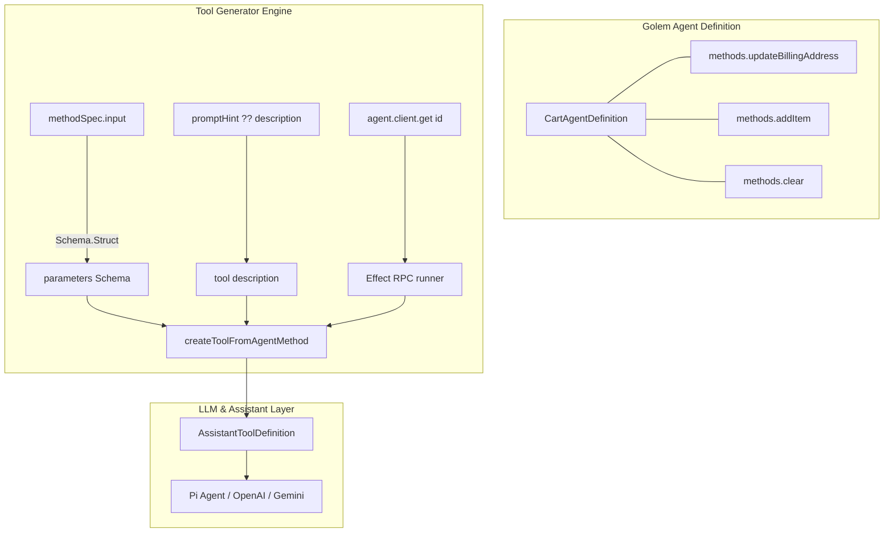

# Feature Implementation Plan: Automatic Agent Method Tool Generator

- **Feature ID / Slug**: `agent-method-tool-generator`
- **Proposed By**: User & Antigravity Pair Programming
- **Date**: 2026-11-01
- **Status**: Pending User Approval

---

## 1. Overview & Goals

Currently, domain tools used by the AI Shopping Assistant (`add_to_cart`, `clear_cart`, `set_billing_address`, `set_shipping_address`, `checkout_cart`, etc.) are manually declared in two separate files:
1. [`shopping-assistant-tool-specs.ts`](../../src/agents/shopping-assistant/shopping-assistant-tool-specs.ts): ~380 lines manually duplicating argument schemas (`SetAddressArgs`, `AddToCartArgs`, etc.), descriptions, and spec types.
2. [`shopping-assistant-tools.ts`](../../src/agents/shopping-assistant/shopping-assistant-tools.ts): ~470 lines manually wrapping each spec in an RPC client call (`yield* CartAgentDefinition.get({ id: ctx.userId })`) and result stringifier.

Whenever an agent method definition changes (e.g. adding a phone number or postal code validation), these tool definitions must be manually updated in lockstep, creating maintenance overhead and risk of drift.

### Objectives
1. **Single Source of Truth**: Leverage Golem method definitions (`AgentSpec.methods[methodName]`) as the canonical source for tool parameter schemas (`methodSpec.input`), documentation (`methodSpec.description`), and LLM guidance (`methodSpec.promptHint`).
2. **Automatic Tool Generator (`createToolFromAgentMethod`)**: Implement a generic utility that dynamically compiles a Golem `MethodSpec` into an `AssistantToolDefinition` compatible with Pi Agent and LLM tool calling.
3. **Batch Tool Generator (`createToolsFromAgent`)**: Enable batch generation of assistant tools from an entire agent definition with configurable identity resolution (`resolveId`) and custom UI summary formatters.
4. **Annotate Domain Methods**: Enhance `CartAgentDefinition` (and related agents) with rich `description` and `promptHint` annotations following Golem's [`golem-annotate-agent-effect`](../../.agents/skills/golem-annotate-agent-effect/SKILL.md) standard.
5. **Backwards Compatibility**: Ensure generated tools seamlessly satisfy existing tool collections (`shoppingAssistantTools`, `shoppingAssistantToolSpecs`, and `toPiAgentTool`) with zero breakage to existing tests or the frontend.

---

## 2. Architecture & Design

### 2.1 Component Flow



### 2.2 MethodSpec to AssistantTool Mapping

| `MethodSpec` Property | Assistant Tool Property | Transformation / Resolution |
| :--- | :--- | :--- |
| Method Name (e.g. `updateBillingAddress`) | `name` | Default: `snake_case` (`update_billing_address`), or override via `toolName` option. |
| `methodSpec.input` (`Record<string, Schema>`) | `parameters` | `Schema.Struct(methodSpec.input)` (preserves all field annotations and descriptions). |
| `methodSpec.promptHint` / `description` | `description` | `options.description ?? methodSpec.promptHint ?? methodSpec.description`. |
| `methodSpec.success` & `methodSpec.error` | Output & Errors | Uses Effect 4's native `Result` (`.pipe(Effect.result)`): `{ "_tag": "Success", "value" }` or `{ "_tag": "Failure", "failure" }`. |
| Agent ID (`AgentSpec.id`) | RPC Target | Resolved via caller-provided `resolveId(ctx: ToolContext)`. |

### 2.3 Effect 4 `Result` Representation for Tools

When an agent method executes, it is piped through `Effect.result`, transforming `Effect<Success, Error>` into an infallible `Effect<Result<Success, Error>>`:

- **On Success**:
  ```json
  {
    "_tag": "Success",
    "value": {
      "userId": "user-123",
      "items": [{ "productId": "ap001", "quantity": 1 }],
      "total": 49.99
    }
  }
  ```
- **On Typed Failure** (e.g. `UpdateAddressError`, `AddItemError`):
  ```json
  {
    "_tag": "Failure",
    "failure": {
      "_tag": "InvalidPostalCode",
      "message": "Postal code 'ABC' is invalid for country 'US'"
    }
  }
  ```

This provides:
1. Native alignment with Effect 4 (`Result.succeed`, `Result.fail`, `Result.isSuccess`, `Result.isFailure`).
2. Preservation of domain-specific typed errors without throwing or losing fields.
3. Crystal-clear discriminator (`_tag: "Success"` vs `_tag: "Failure"`) for the LLM to understand whether to celebrate success or prompt the user for corrections.

### 2.4 Proposed API Signatures

```typescript
// src/agents/shopping-assistant/shopping-assistant-tool-generator.ts

export interface MethodToolOptions<TMethodName extends string, TIdInput> {
  readonly toolName?: string;
  readonly description?: string;
  readonly resolveId: (ctx: ToolContext) => TIdInput;
  readonly formatSummary?: (result: any, args: any) => string;
}

export function createToolFromAgentMethod<
  TAgentSpec extends AgentSpec<any, any, any>,
  TMethodName extends keyof TAgentSpec["methods"] & string,
>(
  agent: TAgentSpec,
  methodName: TMethodName,
  options: MethodToolOptions<TMethodName, any>,
): AssistantToolDefinition;

export function createToolsFromAgent<TAgentSpec extends AgentSpec<any, any, any>>(
  agent: TAgentSpec,
  config: {
    readonly resolveId: (ctx: ToolContext) => any;
    readonly methods: {
      [K in keyof TAgentSpec["methods"]]?: {
        readonly toolName?: string;
        readonly description?: string;
        readonly formatSummary?: (result: any, args: any) => string;
      };
    };
  },
): AssistantToolDefinition[];
```

---

## 3. File-by-File Changes

| Action | File Path | Description |
| :--- | :--- | :--- |
| `[NEW]` | `src/agents/shopping-assistant/shopping-assistant-tool-generator.ts` | Generic `createToolFromAgentMethod` and `createToolsFromAgent` implementation that transforms Golem `MethodSpec` objects into `AssistantToolDefinition` instances. |
| `[MODIFY]` | `src/agents/cart/cart-definition.ts` | Add rich `description` and `promptHint` metadata to cart methods (`updateBillingAddress`, `updateShippingAddress`, `addItem`, `removeItem`, `clear`, `getSavedContactInfo`, `applySavedContactInfo`, `checkout`) and annotate input fields. |
| `[MODIFY]` | `src/agents/shopping-assistant/shopping-assistant-tools.ts` | Refactor Cart agent tools to use `createToolsFromAgent` / `createToolFromAgentMethod`, eliminating redundant manual boilerplate while exporting the same tools. |
| `[NEW]` | `test/tool-generator.test.ts` | Unit tests verifying that generated tools derive correct parameter schemas, descriptions, handle RPC invocation, and format outputs accurately. |

---

## 4. Verification & Validation Plan

### 4.1 Automated Validation Commands

1. **Prettier Code Formatting**:
   ```bash
   npm run format
   npm run format:check
   ```
2. **TypeScript Strict Typecheck**:
   ```bash
   npm run typecheck
   ```
   Ensures method names, inputs, and RPC client types are strictly verified with 0 errors.
3. **ESLint Verification**:
   ```bash
   npm run lint
   ```
   Ensures 0 lint errors, 0 unused imports, and strict adherence to rules.
4. **Unit & Integration Tests**:
   ```bash
   npm test
   ```
   Executes existing 21 unit tests plus new tests in `test/tool-generator.test.ts`.
5. **Golem Component Build**:
   ```bash
   golem build --yes
   ```
   Ensures the updated agent definitions compile and preinitialize into WASM cleanly.

---

## 5. Risks & Mitigations

- **Risk**: Some agent methods require zero arguments (e.g. `clear()`, `checkout()`, `getSavedContactInfo()`), where `methodSpec.input` is `{}`.
  - **Mitigation**: `Schema.Struct({})` correctly produces an empty object schema that LLMs understand as requiring no parameters.
- **Risk**: RPC clients in Golem require an ambient context when running inside a fiber.
  - **Mitigation**: The execution runner uses `Effect.gen` and respects the ambient `Context.Context` passed down via `toPiAgentTool` / `toPiAgentTools`.
- **Risk**: Tool names used by existing frontend or prompts might differ from `snake_case(methodName)` (e.g. `checkout` method vs `checkout_cart` tool).
  - **Mitigation**: The generator provides an optional `toolName` override for full backwards compatibility with existing prompt instructions and tests.

