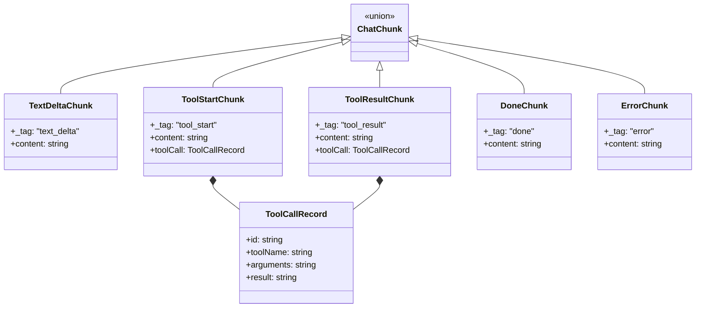
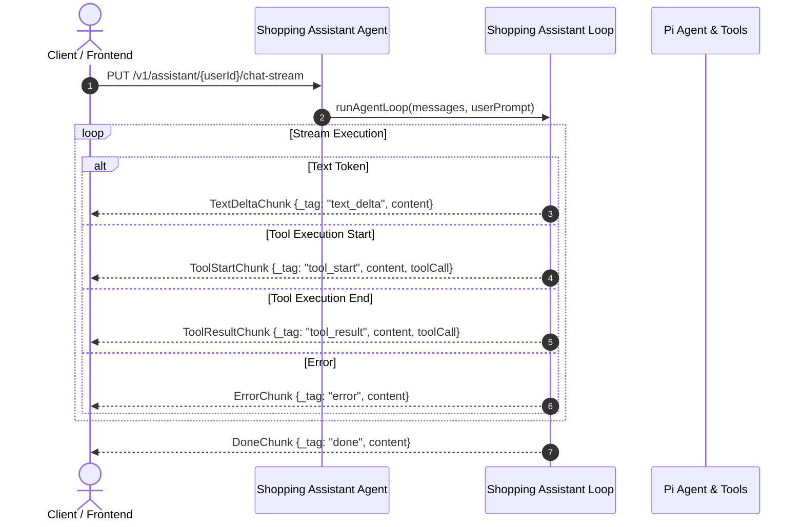

# Feature Implementation Plan: ChatChunk Discriminated Union

- **Feature ID / Slug**: `chat-chunk-discriminated-union`
- **Proposed By**: User & Agent Pair Programming
- **Date**: 2026-11-01
- **Status**: Pending User Approval

---

## 1. Overview & Goals

Currently, `ChatChunk` is defined as a monolithic struct:
```typescript
export const ChatChunk = Schema.Struct({
  type: ChatChunkType, // "text_delta" | "tool_start" | "tool_result" | "done" | "error"
  content: Schema.String,
  toolCall: ToolCallRecord, // { id: string, toolName: string, arguments: string, result: string }
});
```
While this avoided Golem's `option<option<_>>` stream validation bug, it requires every chunk—including every single token emitted during text generation (`text_delta`)—to carry a dummy `toolCall: { id: "", toolName: "", arguments: "", result: "" }` payload.

### Objectives
1. **Model Accuracy & Type Safety**: Replace the monolithic struct with an Effect tagged union (`Schema.TaggedStruct`), where only `tool_start` and `tool_result` carry a `toolCall: ToolCallRecord`, while `text_delta`, `done`, and `error` carry only `content`.
2. **Payload Efficiency**: Eliminate sending dummy empty strings on every streamed token chunk.
3. **Golem WIT Compatibility**: Use `_tag` as the discriminator property to generate a clean WIT `variant` supported by Golem's `WitCodec` without `option<...>` nesting.
4. **Resilient Frontend Consumption**: Support both `{ _tag: "..." }` and single-key WIT variant objects (`{ text_delta: { ... } }`) in the frontend SSE stream reader.

---

## 2. Architecture & Design

### 2.1 Backend Schema (`src/agents/shopping-assistant/shopping-assistant-schema.ts`)



- Schema definition using `Schema.TaggedStruct`:
  - `TextDeltaChunk`: `_tag: "text_delta"`, `content: Schema.String`
  - `ToolStartChunk`: `_tag: "tool_start"`, `content: Schema.String`, `toolCall: ToolCallRecord`
  - `ToolResultChunk`: `_tag: "tool_result"`, `content: Schema.String`, `toolCall: ToolCallRecord`
  - `DoneChunk`: `_tag: "done"`, `content: Schema.String`
  - `ErrorChunk`: `_tag: "error"`, `content: Schema.String`
  - `ChatChunk`: `Schema.Union([TextDeltaChunk, ToolStartChunk, ToolResultChunk, DoneChunk, ErrorChunk])`

### 2.2 Streaming Flow



---

## 3. File-by-File Changes

| Action | File Path | Description |
| :--- | :--- | :--- |
| `[MODIFY]` | `src/agents/shopping-assistant/shopping-assistant-schema.ts` | Define `TextDeltaChunk`, `ToolStartChunk`, `ToolResultChunk`, `DoneChunk`, `ErrorChunk` as `Schema.TaggedStruct`, and `ChatChunk` as `Schema.Union`. Remove redundant `ChatChunkType`. |
| `[MODIFY]` | `src/agents/shopping-assistant/shopping-assistant-loop.ts` | Update chunk creation helper functions to construct typed union chunks (`_tag: "text_delta"`, etc.) without dummy `toolCall` fields on text/done/error chunks. |
| `[MODIFY]` | `frontend/src/api/services/assistantService.ts` | Define TypeScript union types for `ChatChunk`. Add `normalizeChatChunk` to seamlessly unpack both direct `{ _tag: "..." }` and single-key WIT variant objects (`{ text_delta: { ... } }`) from SSE messages. |
| `[MODIFY]` | `frontend/src/stores/assistantStore.ts` | Update stream listener to switch on `chunk._tag` with strict TypeScript type narrowing. |

---

## 4. Verification & Validation Plan

1. **Code Formatting**:
   ```bash
   npm run format
   npm run format:check
   ```
2. **TypeScript Compilation**:
   ```bash
   npm run typecheck
   ```
3. **Linter Check**:
   ```bash
   npm run lint
   ```
4. **Unit & Integration Test Suite**:
   ```bash
   npm test
   ```
5. **Golem WASM Build**:
   ```bash
   golem build --yes
   ```
   Verify that Golem's `validateSchemaGraph` compiles the `ChatChunk` WIT variant into the stream schema with zero validation errors.

---

## 5. Risks & Mitigations

- **Risk**: Golem's HTTP SSE / Durable Streams serialization could send the variant as `{ "text_delta": { "content": "..." } }` (single-key variant envelope) instead of `{ "_tag": "text_delta", ... }`.
- **Mitigation**: Implement `normalizeChatChunk` in `assistantService.ts` to inspect both formats and normalize them into a standard `{ _tag: "..." }` object before delivering to `assistantStore`.

