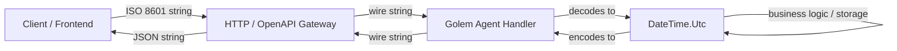

# Feature Plan: Migrate Timestamps to Schema.DateTimeUtcFromString

- **Feature ID / Slug**: `datetime-utc-string-migration`
- **Date**: 2026-10-31
- **Status**: Draft

---

## 1. Overview & Goals

Currently, the project uses `@golemcloud/effect-golem`'s `Datetime.Datetime` (`{ seconds: bigint, nanoseconds: number }`) across backend schemas (`Order`, `Cart`, `Product`, `ProductSearch`, `Pricing`, `UserPreferences`). When generating OpenAPI specifications or serving REST/JSON payloads, this WebAssembly record exposes as a nested integer object with `BigInt` seconds, requiring custom serialization workarounds and complicating frontend date handling.

This feature plan migrates all date-time fields across agent schemas to `Schema.DateTimeUtcFromString` from Effect, ensuring:
1. **OpenAPI Compatibility**: Date-time fields in OpenAPI specifications appear as standard ISO-8601 strings (`type: "string", format: "date-time"`).
2. **Standard Wire Representation**: JSON payloads across the wire use standard ISO-8601 UTC timestamp strings (e.g. `"2026-10-31T18:00:00.000Z"`).
3. **Type-Safe Backend Domain**: Agent handlers work natively with Effect's `DateTime.Utc` without manual conversions between nanosecond bigints and JS Dates.
4. **Simplified Frontend**: The frontend types and services are updated so `DateTime` is represented as an ISO string, simplifying formatting and parsing directly via `new Date(isoString)`.

### Goals

- Replace `Datetime.Datetime` with `Schema.DateTimeUtcFromString` in all agent schemas (`cart`, `order`, `pricing`, `product`, `product-search`, `shopping-assistant`).
- Update `getCurrentDatetime` in `src/common/models.ts` to return `DateTime.Utc` directly (`DateTime.now`).
- Update `pricing-schema.ts` `datetimeKey` helper to serialize `DateTime.Utc` as ISO string.
- Update test mocks (e.g., `test/product-query-matcher.test.ts`) to use `DateTime.Utc`.
- Update frontend datetime definitions in `frontend/src/types/datetime.ts` and associated API services/views to handle ISO-8601 strings.
- Pass full backend validation: formatting, linting, typechecking, unit tests, and `golem build --yes`.

### Non-Goals

- Migrating low-level Golem host scheduler calls (`scheduleInvocation`) which remain internal to Golem host primitives.
- Changing database engines or altering business logic not related to date fields.

---

## 2. Architecture & Technical Design

### Backend Schema Architecture

In Effect 4 / `@golemcloud/effect-golem`:
- `Schema.DateTimeUtcFromString`:
  - **Type (Handler)**: `DateTime.Utc`
  - **Encoded (Wire / OpenAPI / WIT)**: `string` (ISO 8601)
- When incoming JSON contains an ISO string, Effect automatically validates and decodes it into a `DateTime.Utc` object.
- When an agent method returns a record, Effect automatically encodes `DateTime.Utc` into an ISO-8601 string.
- WIT interface exposed by Golem treats these fields as `string`, which simplifies compatibility across HTTP clients and OpenAPI tools.



### Frontend Architecture

- In `frontend/src/types/datetime.ts`, `DateTime` is redefined as `string` (ISO-8601 timestamp string).
- For backward compatibility and robustness against any legacy payloads, `dateTimeToDate` converts both ISO strings and `{ seconds, nanoseconds }` objects into JavaScript `Date` instances:
  ```typescript
  export type DateTime = string;
  export function dateTimeToDate(dateTime: DateTime | { seconds: number; nanoseconds: number }): Date {
    if (typeof dateTime === "string") {
      return new Date(dateTime);
    }
    return new Date(dateTime.seconds * 1000 + Math.floor(dateTime.nanoseconds / 1_000_000));
  }
  export function dateToDateTime(date: Date): DateTime {
    return date.toISOString();
  }
  ```
- Services and Vue components that format dates using `dateTimeToDate` continue to work without disruption, now receiving native ISO strings.

---

## 3. Proposed Changes & File Impact

| Action | File Path | Description |
| :--- | :--- | :--- |
| `[MODIFY]` | [`src/common/models.ts`](../../src/common/models.ts) | Update `getCurrentDatetime` to return `DateTime.Utc` (`DateTime.now`). |
| `[MODIFY]` | [`src/agents/order/order-schema.ts`](../../src/agents/order/order-schema.ts) | Change `createdAt` & `updatedAt` to `Schema.DateTimeUtcFromString`. |
| `[MODIFY]` | [`src/agents/product/product-schema.ts`](../../src/agents/product/product-schema.ts) | Change `createdAt` & `updatedAt` to `Schema.DateTimeUtcFromString`. |
| `[MODIFY]` | [`src/agents/product-search/product-search-agent.ts`](../../src/agents/product-search/product-search-agent.ts) | Change `createdAt` & `updatedAt` on `ProductSearchResult` to `Schema.DateTimeUtcFromString`. |
| `[MODIFY]` | [`src/agents/cart/cart-schema.ts`](../../src/agents/cart/cart-schema.ts) | Change `updatedAt` to `Schema.DateTimeUtcFromString`. |
| `[MODIFY]` | [`src/agents/pricing/pricing-schema.ts`](../../src/agents/pricing/pricing-schema.ts) | Change `start`, `end`, `createdAt`, `updatedAt` to `Schema.DateTimeUtcFromString`; update `datetimeKey`. |
| `[MODIFY]` | [`src/agents/shopping-assistant/shopping-assistant-schema.ts`](../../src/agents/shopping-assistant/shopping-assistant-schema.ts) | Change `createdAt` & `updatedAt` to `Schema.DateTimeUtcFromString`. |
| `[MODIFY]` | [`test/product-query-matcher.test.ts`](../../test/product-query-matcher.test.ts) | Update sample product timestamps to `DateTime.Utc`. |
| `[MODIFY]` | [`frontend/src/types/datetime.ts`](../../frontend/src/types/datetime.ts) | Update `DateTime` type to `string`, adapt `dateTimeToDate` & `dateToDateTime`. |
| `[MODIFY]` | [`frontend/src/api/services/orderService.ts`](../../frontend/src/api/services/orderService.ts) | Keep typing aligned with `DateTime` as string. |
| `[MODIFY]` | [`frontend/src/api/services/pricingService.ts`](../../frontend/src/api/services/pricingService.ts) | Keep typing aligned with `DateTime` as string. |
| `[MODIFY]` | [`frontend/src/api/services/cartService.ts`](../../frontend/src/api/services/cartService.ts) | Keep typing aligned with `DateTime` as string. |

---

## 4. Verification Plan

### Automated Checks

1. **Backend Formatting**:
   ```bash
   npm run format:check
   ```
2. **Backend Type Checking**:
   ```bash
   npm run typecheck
   ```
3. **Backend Linter Verification**:
   ```bash
   npm run lint
   ```
4. **Backend Automated Tests**:
   ```bash
   npm test
   ```
5. **Golem Component Build**:
   ```bash
   golem build --yes
   ```
6. **Frontend Linting & Checks**:
   ```bash
   cd frontend && npm run lint
   ```

---

## 5. Risks & Open Questions

- **Risk**: Existing deployed agent state in local test environments might contain serialized `{ seconds, nanoseconds }` records.
  - *Mitigation*: In development, local environments can be redeployed / state reset with `golem agent delete` / `golem deploy`.
- **Open Questions**: None. The conversion from `Datetime.Datetime` to `Schema.DateTimeUtcFromString` directly achieves the user's objective of string-based OpenAPI definitions.

