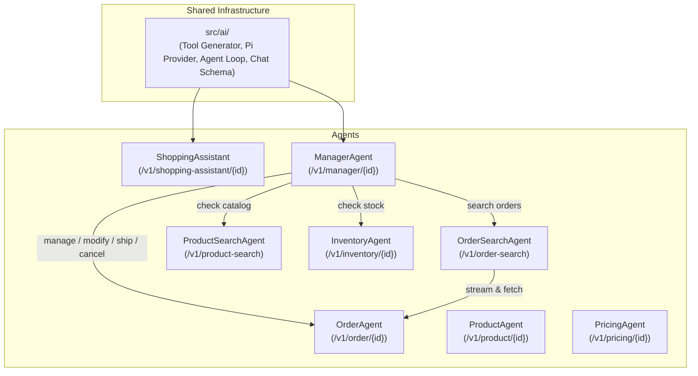

# Feature Implementation Plan: ManagerAgent & OrderSearchAgent

## Overview & Goals
Introduce a dedicated **`ManagerAgent`** for store administration and management workflows, powered by the Pi AI agent framework (`@earendil-works/pi-agent-core`), along with an **`OrderSearchAgent`** for querying and indexing orders across the system. 

As part of this effort, the LLM agent and tool framework currently residing in `src/agents/shopping-assistant/` will be generalized into a reusable `src/ai/` infrastructure module to eliminate duplication and support multiple domain agents (`ShoppingAssistant`, `ManagerAgent`, and future agents).

### Key Objectives
1. **Generalize Pi Agent & Tool Infrastructure**:
   - Extract common tool generator, Pi AI provider setup, event loop, and streaming primitives from `shopping-assistant` into `src/ai/`.
   - Maintain full backward compatibility for `ShoppingAssistant`.
2. **Implement `OrderSearchAgent`**:
   - Provide system-wide order search and discovery using Golem's `Agents.getAgents` API with `OrderAgent(` prefix filtering.
   - Support filtering by status (`new`, `shipped`, `cancelled`), `userId`, text search (order ID, email, name, items), and sorting by creation timestamp.
   - Expose REST API at `/v1/order-search/**`.
3. **Implement `ManagerAgent`**:
   - Durable agent with conversational state mounted at `/v1/manager/{id}`.
   - Powered by Pi Agent (`@earendil-works/pi-agent-core`) with multi-turn conversation and tool calling.
   - Full suite of management tools to inspect, modify, cancel, and ship orders, as well as query catalog and inventory.
4. **Docs & Architecture**:
   - Update `architecture.puml` and `README.md`.
   - Full unit test coverage and Golem WASM build verification.

---

## Architecture & Design

### 1. Module Structure


### 2. Generalized `src/ai/` Subsystem
- **`src/ai/ai-schema.ts`**:
  - `ChatMessage`: `{ role: "user" | "assistant" | "system", content: string, toolCalls?: ToolCallRecord[] }`
  - `ChatChunk`: streaming text deltas and tool invocation markers.
  - `ToolCallRecord`: metadata of tool invocations.
- **`src/ai/models-provider.ts`**:
  - `setupModelsAndProvider`: configures OpenRouter, Google Gemini (with thought signatures), or dynamic OpenAI endpoints.
- **`src/ai/tool-generator.ts`**:
  - Generalized `createToolFromAgentMethod` and `createToolsFromAgent`.
  - Flexible `ToolContext` allowing agent-specific or user-specific metadata.
- **`src/ai/pi-tools.ts`**:
  - Converts domain `AssistantToolDefinition` into Pi Agent `AgentTool<TSchema>` with customizable logger namespace (`[ShoppingAssistant]`, `[ManagerAgent]`).
- **`src/ai/agent-loop.ts`**:
  - Generalized Pi AI agent execution loop supporting both full-response (`runAgentChat`) and stream-response (`streamAgentChat`).
- **`src/ai/index.ts`**:
  - Clean exports for consumption by any agent.

### 3. `OrderSearchAgent` Contract & Capabilities
- **Agent Specification**:
  - Name: `"OrderSearchAgent"`
  - Mode: `"durable"`
  - Id: `{}` (singleton)
  - HTTP Mount: `/v1/order-search`
- **Methods**:
  - `searchOrders({ query?, status?, userId?, limit? })`: Searches and filters orders across all `OrderAgent` instances.
  - `getOrdersByUserId({ userId, limit? })`: Finds orders placed by a specific user.
  - `getOrdersByStatus({ status, limit? })`: Finds orders by order status (`new`, `shipped`, `cancelled`).
  - `getRecentOrders({ limit? })`: Lists recent orders sorted descending by `createdAt`.
- **Implementation Strategy**:
  - Resolves component ID via `Agents.resolveComponentId("golem-shopping-effect:effect-main")` or self metadata.
  - Streams agent IDs using `Agents.getAgents` with `Agents.Filter.name("starts-with", "OrderAgent(")`.
  - Fetches order details concurrently in bounded chunks (5 concurrent) via `OrderAgent.client.get({ id })`.
  - Filters by query matcher (text match on `orderId`, `email`, shipping name, product names/brands in items) and status.

### 4. `ManagerAgent` Contract & Capabilities
- **Agent Specification**:
  - Name: `"ManagerAgent"`
  - Mode: `"durable"`
  - Id: `{ id: Schema.String }` (e.g. manager ID or session ID)
  - Config: `ManagerAgentConfig` (providing `llm: { apiKey, model, apiUrl }`)
  - HTTP Mount: `/v1/manager/{id}`
- **State**:
  - `managerId: string`
  - `history: ChatMessage[]`
- **Methods (1:1 Symmetry with ShoppingAssistant)**:
  - `chat`:
    - `input: { message: Schema.String }`
    - `success: ChatResponse` (contains `reply: string`, `toolCallsUsed: ToolCallRecord[]`, `messages: ChatMessage[]`)
    - `http: [Http.post("/chat")]`
    - Synchronous conversational turn with tool execution.
  - `chatStream`:
    - `input: { message: Schema.String }`
    - `success: WitTypes.AgentStream(ChatChunk)`
    - `http: [Http.post("/chat-stream")]`
    - Live streaming of text deltas and tool call start/end events via Golem durable streams.
  - `getHistory`:
    - `input: {}`
    - `success: Schema.Array(ChatMessage)`
    - `readOnly: true`
    - `http: [Http.get("/history")]`
    - Returns full persisted conversation history.
  - `clearHistory`:
    - `input: {}`
    - `success: Schema.Void`
    - `http: [Http.post("/clear-history")]`
    - Clears conversation history for the session.
- **Manager Tools**:
  1. `search_orders`: Search orders by query, status, or userId (`OrderSearchAgent.searchOrders`).
  2. `get_order_details`: Retrieve full order state by orderId (`OrderAgent.get`).
  3. `list_recent_orders`: List recent orders across the system (`OrderSearchAgent.getRecentOrders`).
  4. `ship_order`: Transition order from `new` to `shipped` (`OrderAgent.shipOrder` -> triggers inventory fulfillment).
  5. `cancel_order`: Cancel a `new` order (`OrderAgent.cancelOrder` -> triggers inventory release).
  6. `add_order_item`: Add product item to an existing `new` order (`OrderAgent.addItem`).
  7. `remove_order_item`: Remove product item from an existing `new` order (`OrderAgent.removeItem`).
  8. `update_order_item_quantity`: Adjust quantity of an item in an existing `new` order (`OrderAgent.updateItemQuantity`).
  9. `update_order_shipping_address`: Update recipient shipping address (`OrderAgent.updateShippingAddress`).
  10. `update_order_billing_address`: Update billing address (`OrderAgent.updateBillingAddress`).
  11. `update_order_email`: Update customer email (`OrderAgent.updateEmail`).
  12. `check_product_details`: Inspect product specs, brand, tags (`ProductAgent.get`).
  13. `check_inventory`: Inspect stock and allocated quantities for a product (`InventoryAgent.get` / `getAvailableQuantity`).
  14. `search_products`: Search catalog for product items (`ProductSearchAgent.searchProducts`).

---

## File-by-File Changes

### 1. Generalized AI / Pi Agent Infrastructure
- **`[NEW]` `src/ai/ai-schema.ts`**: Common schemas for chat messages, deltas, and tool records.
- **`[NEW]` `src/ai/models-provider.ts`**: Pi AI model and provider setup.
- **`[NEW]` `src/ai/tool-generator.ts`**: Agent-to-tool derivation utilities.
- **`[NEW]` `src/ai/pi-tools.ts`**: Conversion to Pi AI `AgentTool`.
- **`[NEW]` `src/ai/agent-loop.ts`**: Pi Agent turn loop and stream generator.
- **`[NEW]` `src/ai/index.ts`**: Public exports for AI subsystem.
- **`[MODIFY]` `src/agents/shopping-assistant/*`**: Re-export or forward to `src/ai/` to maintain 100% backward compatibility without code duplication.

### 2. Order Search Agent
- **`[NEW]` `src/agents/order-search/order-query-matcher.ts`**: In-memory text and status matcher for orders.
- **`[NEW]` `src/agents/order-search/order-search-agent.ts`**: `OrderSearchAgent` implementation with Golem agent discovery.
- **`[NEW]` `src/agents/order-search/index.ts`**: Module exports.

### 3. Manager Agent
- **`[NEW]` `src/agents/manager/manager-definition.ts`**: `defineAgent` specification for `ManagerAgent`.
- **`[NEW]` `src/agents/manager/manager-tools.ts`**: Domain tool definitions wrapping `OrderAgent`, `OrderSearchAgent`, `ProductAgent`, and `InventoryAgent`.
- **`[NEW]` `src/agents/manager/manager-agent.ts`**: Implementation with Pi AI agent loop, streaming, and durable history.
- **`[NEW]` `src/agents/manager/index.ts`**: Module exports.

### 4. Integration & Documentation
- **`[MODIFY]` `src/main.ts`**: Register `OrderSearchAgent` and `ManagerAgent`.
- **`[MODIFY]` `architecture.puml`**: Add `ManagerAgent` and `OrderSearchAgent`, HTTP gateway routes (`/v1/manager/**`, `/v1/order-search/**`), and RPC connections.
- **`[MODIFY]` `README.md`**: Document `ManagerAgent` and `OrderSearchAgent` capabilities and endpoints.
- **`[NEW]` `test/order-query-matcher.test.ts`**: Unit tests for order search query parsing and matching.
- **`[NEW]` `test/manager-tools.test.ts`**: Unit tests for manager tool derivation, schema validation, and execution.

---

## Verification Plan

### Automated Validation
1. **TypeScript Typecheck**:
   ```bash
   npm run typecheck
   ```
   Must pass with 0 errors in strict mode.
2. **Formatting**:
   ```bash
   npm run format:check
   ```
   Must verify all files conform to Prettier rules. Auto-format via `npm run format`.
3. **Linter**:
   ```bash
   npm run lint
   ```
   Must pass with 0 errors and no unused imports.
4. **Unit Tests**:
   ```bash
   npm test
   ```
   Must pass all existing 34 tests plus new tests for order search matching and manager tools.
5. **Golem Component Build**:
   ```bash
   npm run build # golem build --yes
   ```
   Must successfully bundle with Rollup, compile, inject into QuickJS WASM runtime, and preinitialize without errors.

---

## Risks & Trade-offs
1. **OrderAgent Discovery Performance**:
   - `Agents.getAgents` streams agent IDs matching `OrderAgent(`. For large scale, fetching orders in batches of 5 avoids spiking memory while keeping response times fast.
2. **Safety in Manager Actions**:
   - Order modification methods (`addItem`, `removeItem`, `updateItemQuantity`, `cancelOrder`, `shipOrder`) in `OrderAgent` already enforce status constraints (`orderStatus === "new"`). If an order is already `shipped` or `cancelled`, `ActionNotAllowedError` is returned and cleanly summarized by the manager tool.
3. **LLM Provider Compatibility**:
   - By generalizing `setupModelsAndProvider`, `ManagerAgent` automatically inherits support for Google Gemini (including thought signatures), OpenRouter, and OpenAI-compatible gateways.

