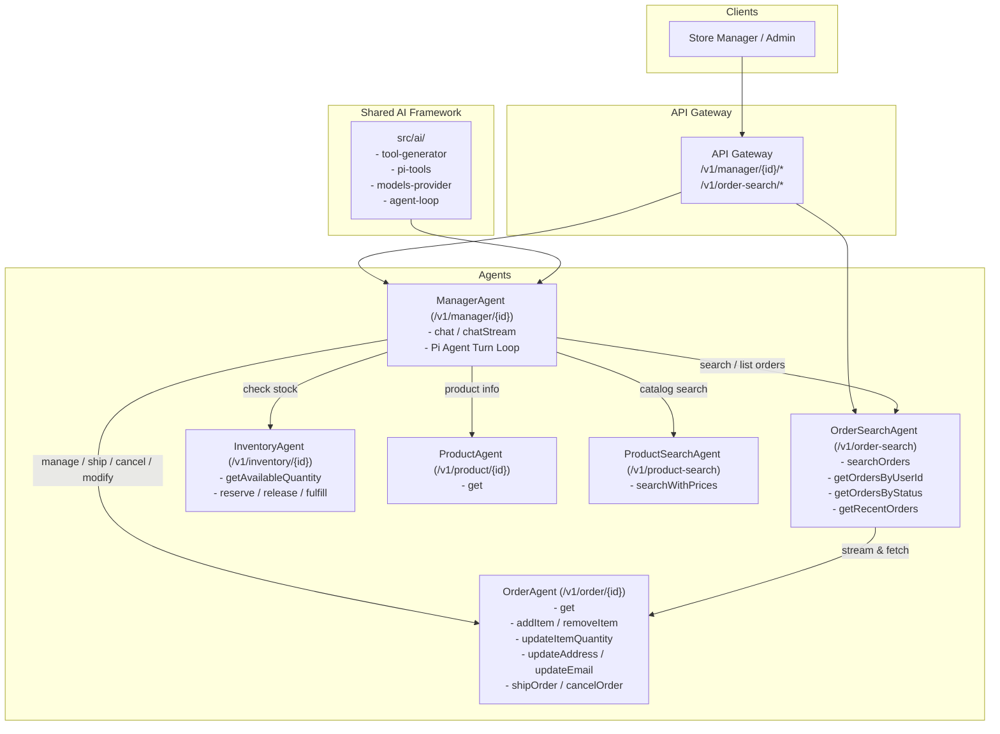

# Implementation Walkthrough: ManagerAgent & OrderSearchAgent

## Overview

This implementation introduces:
1. **Generalized AI / Pi Agent Infrastructure (`src/ai/`)**:
   - Reusable tool generator (`tool-generator.ts`), Pi AI provider configuration (`models-provider.ts`), agent tool adapters (`pi-tools.ts`), agent conversational loop (`agent-loop.ts`), and common chat/streaming schemas (`ai-schema.ts`).
   - Seamlessly shared across both `ShoppingAssistantAgent` and `ManagerAgent` without code duplication.
2. **`OrderSearchAgent` (`src/agents/order-search/`)**:
   - Durable singleton agent mounted at `/v1/order-search`.
   - Discovers and indexes orders across the system via Golem's `Agents.getAgents` streaming API.
   - Provides search across queries, status filters (`new`, `shipped`, `cancelled`), customer `userId`, and date-sorted ordering.
3. **`ManagerAgent` (`src/agents/manager/`)**:
   - Durable agent with conversational state mounted at `/v1/manager/{id}`.
   - 1:1 API symmetry with `ShoppingAssistant`: `chat`, `chatStream` (`WitTypes.AgentStream(ChatChunk)`), `getHistory`, `clearHistory`.
   - Comprehensive store management toolset to search, inspect, modify, cancel, and ship orders, and inspect catalog/inventory.

---

## Architecture & Data Flow



---

## Management Tools Suite

The `ManagerAgent` has access to the following 14 tools:

| Category | Tool Name | Target Agent & Method | Description |
|---|---|---|---|
| **Order Discovery** | `search_orders` | `OrderSearchAgent.searchOrders` | Search orders across system by query text, status, or userId |
| | `list_recent_orders` | `OrderSearchAgent.getRecentOrders` | List most recent orders across the store |
| | `get_order_details` | `OrderAgent.get` | Retrieve full order details including line items, addresses, status, total |
| **Order Lifecycle** | `ship_order` | `OrderAgent.shipOrder` | Mark order as shipped and fulfill allocated inventory |
| | `cancel_order` | `OrderAgent.cancelOrder` | Cancel order and release reserved inventory allocations |
| **Order Modification** | `add_order_item` | `OrderAgent.addItem` | Add a product item to a 'new' order (reserves inventory) |
| | `remove_order_item` | `OrderAgent.removeItem` | Remove a product item from a 'new' order (releases inventory) |
| | `update_order_item_quantity` | `OrderAgent.updateItemQuantity` | Adjust line item quantity (adjusts inventory reservation) |
| | `update_order_shipping_address`| `OrderAgent.updateShippingAddress` | Update recipient shipping address on a 'new' order |
| | `update_order_billing_address` | `OrderAgent.updateBillingAddress` | Update billing address on a 'new' order |
| | `update_order_email` | `OrderAgent.updateEmail` | Update customer contact email on a 'new' order |
| **Catalog & Stock** | `check_product_details` | `ProductAgent.get` | Inspect product specifications, brand, and tags |
| | `check_inventory` | `InventoryAgent.getAvailableQuantity` | Inspect available and total stock quantity for a product |
| | `search_products` | `ProductSearchAgent.searchWithPrices` | Search product catalog for keyword, brand, or tag options |

---

## API Endpoints

### Manager Agent (`/v1/manager/{id}`)
- `POST /v1/manager/{id}/chat`: Synchronous chat turn returning `ChatResponse` with reply and tool call records.
- `POST /v1/manager/{id}/chat-stream`: Server-Sent Events / Golem AgentStream emitting live `ChatChunk` tokens and tool start/result events.
- `GET /v1/manager/{id}/history`: Returns complete persisted conversation history `ChatMessage[]`.
- `POST /v1/manager/{id}/clear-history`: Resets conversation history for the session.

### Order Search Agent (`/v1/order-search`)
- `GET /v1/order-search/search?query={query}&status={status}&userId={userId}&limit={limit}`: Multi-field order search.
- `GET /v1/order-search/user/{userId}?limit={limit}`: Orders by customer ID.
- `GET /v1/order-search/status/{status}?limit={limit}`: Orders by status (`new`, `shipped`, `cancelled`).
- `GET /v1/order-search/recent?limit={limit}`: Recent orders sorted by `createdAt` descending.
- Note: Methods execute without `readOnly: true` because they query Golem's host agent discovery API (`Agents.getAgents`) and perform cross-agent RPCs (`OrderAgent.client.get`), which the Golem host sandbox treats as host-level operations.

### Web Interfaces (`/assistant` and `/manager`)
- `WebAssistant` router (`/assistant`): Serves `web/assistant.html` and `web/assets/*` for customer shopping assistance.
- `WebManager` router (`/manager`): Serves `web/manager.html` and `web/assets/*` for store management operations. Both routers are configured in `golem.yaml` with virtual filesystem mounts to `./web/` and declared in `httpApi`.

---

## Verification Results

1. **TypeScript Typecheck**:
   ```bash
   npm run typecheck
   ```
   Passed with 0 errors in strict mode.

2. **Code Style & Formatting**:
   ```bash
   npm run format:check
   ```
   All files conform to Prettier code style.

3. **Linting**:
   ```bash
   npm run lint
   ```
   Passed with 0 errors.

4. **Automated Unit Tests**:
   ```bash
   npm test
   ```
   **43 tests passing** across 6 test suites:
   - `LLM Error Formatting` (7 tests)
   - `Inventory Schema & Business Logic` (3 tests)
   - `Manager Tools & AI Tool Generation` (2 tests)
   - `OrderQueryMatcher` (7 tests)
   - `Pi Agent & Provider Setup` (7 tests)
   - `ProductQueryMatcher` (6 tests)
   - `Tool Generator` (11 tests)

5. **Golem Component Build**:
   ```bash
   npm run build # golem build --yes
   ```
   Built successfully (`Finished building [OK]`), generating preinitialized WASM component.

