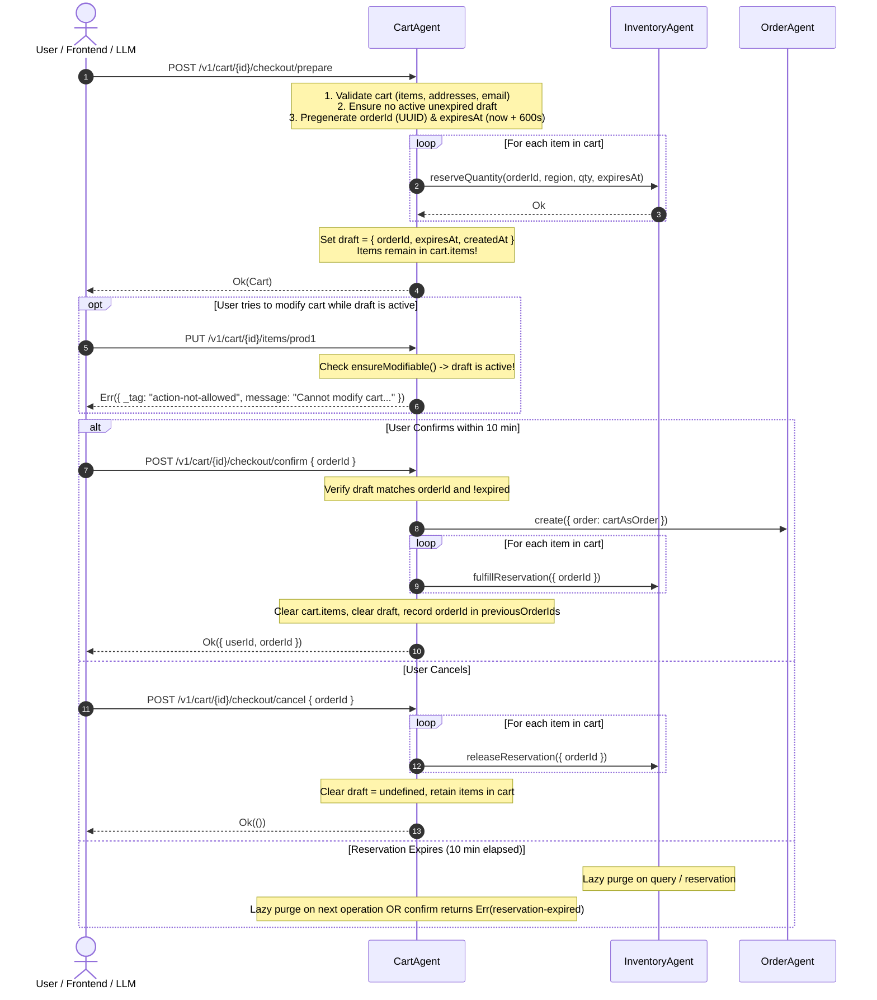

# Feature Plan: Two-Phase Checkout with Inventory Reservation & Expiration

- **Feature ID / Slug**: `prepare-confirm-checkout`
- **Date**: 2026-11-06
- **Status**: Draft <!-- Draft | Approved | In Progress | Completed -->

---

## 1. Overview & Goals

Transition the shopping checkout flow from a single-turn, immediate `checkout()` operation to an enterprise-grade **Two-Phase Checkout (`prepare_checkout` $\to$ `confirm_checkout`)** with time-bounded inventory reservation in the Effect-based Golem application.

This directly mirrors the architecture established in `golem-shopping-rust/docs/implementation/prepare_confirm_checkout_feature_plan.md`, solving concurrency, data consistency, and AI safety challenges when agents and frontends interact with the shopping system:

1. **Concurrency & Stock Guarantees**: Stock is reserved in `InventoryAgent` for 10 minutes (`CHECKOUT_RESERVATION_TTL_SECONDS = 600`) during `prepareCheckout`, guaranteeing items will not be sold out or oversold while the customer reviews the summary.
2. **Deterministic Human-in-the-Loop (HITL)**: The AI shopping assistant *must* call `prepare_checkout` first to obtain an `orderId` and activate `draft: CheckoutDraft`. It cannot execute `confirm_checkout` without explicit user confirmation and an unexpired reservation.
3. **Strict Invariant & Cart Locking**: While a checkout draft is active and unexpired, modifying the cart returns `ActionNotAllowedError`, preventing data races, price mutations, or inconsistent orders.
4. **Zero Data Redundancy**: Cart items, totals, and addresses remain canonical in `Cart`. `CheckoutDraft` is lightweight, holding only reservation metadata (`orderId`, `expiresAt`, `createdAt`).
5. **Price & Item Freezing**: When in active checkout mode, `getCart()` skips dynamic product/pricing refreshes and returns the exact frozen cart state as prepared.
6. **Frontend Transparency**: The web checkout UI and chat assistant clearly communicate the active reservation, display a live countdown timer (`MM:SS`), and provide explicit confirmation and cancellation controls.

### Goals

- Extend `InventoryAgent` with optional `expiresAt` timestamps on allocations, auto-cleanup (lazy purge on queries and reservations), and updated `reserveQuantity` input schema.
- Upgrade `Cart` schema with lightweight `draft: Schema.optional(CheckoutDraft)`.
- Introduce `ActionNotAllowedError` and incorporate it into cart mutation errors (`AddItemError`, `RemoveItemError`, `UpdateItemQuantityError`, `UpdateAddressError`, `UpdateEmailError`, `PrepareCheckoutError`).
- Add `prepareCheckout()`, `confirmCheckout({ orderId })`, and `cancelCheckout({ orderId })` methods to `CartAgentDefinition` and `CartAgent`.
- Preserve legacy `checkout()` as an internal backward-compatible composite of `prepareCheckout` + `confirmCheckout`.
- Update `ShoppingAssistantAgent` tools (`prepare_checkout`, `confirm_checkout`, `cancel_checkout`) and system prompt.
- Update frontend (`cartService.ts`, `cartStore.ts`, `CheckoutView.vue`, `CartView.vue`, and `assistantStore.ts`) to support reservation review, expiration countdown, and confirmation/cancellation actions.
- Add comprehensive automated unit tests covering reservation expiration, cart locking, confirmation, and tool generation.

### Non-Goals

- Replacing the payment gateway integration (mock payment flow remains valid).
- Multi-warehouse routing algorithms (inventory continues using regional availability).
- Persistent database migration (state is persisted via Golem durable agents).

---

## 2. Architecture & Technical Design



### Key Technical Decisions

1. **Lightweight `CheckoutDraft` & Zero Data Duplication**:
   - `CheckoutDraft` contains only:
     ```typescript
     export const CheckoutDraft = Schema.Struct({
       orderId: Schema.String,
       expiresAt: Schema.DateTimeUtcFromString,
       createdAt: Schema.DateTimeUtcFromString,
     });
     ```
   - Items, totals, addresses, and email stay canonical in `Cart`.
   - When `draft` is `undefined` (or expired), cart is in normal shopping mode. When defined and unexpired, cart is in locked checkout mode.
   - `Cart.items` are only cleared when `confirmCheckout` succeeds. They are retained if cancelled or expired.

2. **Cart Invariant Enforcement & Price Freezing**:
   - `ensureModifiable`: Calls `purgeExpiredDraft`. If `draft` is still active, fails with `ActionNotAllowedError`.
   - All mutation operations (`addItem`, `updateItemQuantity`, `removeItem`, `clear`, `updateBillingAddress`, `updateShippingAddress`, `updateEmail`) call `ensureModifiable`.
   - `get()` Price Freeze: If `isInCheckout` is true, returns the existing cart immediately without re-querying `ProductAgent` or `PricingAgent`, ensuring prices locked during checkout do not shift. When not in checkout, dynamic price and product refresh executes as usual.

3. **Atomic Inventory Reservation with Rollback**:
   - During `prepareCheckout`, inventory is reserved item-by-item with the calculated `expiresAt`.
   - If reservation fails for any item (e.g. `insufficient-inventory` or `inventory-not-found`), all items already reserved in this transaction batch are released immediately before returning `insufficient-stock`.

4. **Backward Compatibility**:
   - The existing `checkout()` method in `CartAgentDefinition` remains intact and routes internally to `prepareCheckout()` followed by `confirmCheckout()`. Legacy callers and automated tests will continue functioning without breaking changes.

5. **LLM Tool Alignment**:
   - The monolithic `checkout_cart` tool is replaced with three explicit tools: `prepare_checkout`, `confirm_checkout({ orderId })`, and `cancel_checkout({ orderId })`.
   - The assistant system prompt in `shopping-assistant-loop.ts` is updated to require explicit user confirmation between `prepare_checkout` and `confirm_checkout`.

---

## 3. Proposed Changes & File Impact

| Action     | File Path | Description |
| :--------- | :-------- | :---------- |
| `[MODIFY]` | [`src/common/models.ts`](../../src/common/models.ts) | Add `CHECKOUT_RESERVATION_TTL_SECONDS = 600` constant |
| `[MODIFY]` | [`src/agents/inventory/inventory-schema.ts`](../../src/agents/inventory/inventory-schema.ts) | Add `expiresAt` to `OrderAllocation`, add `purgeExpiredAllocations` and expiration helper functions |
| `[MODIFY]` | [`src/agents/inventory/inventory-agent.ts`](../../src/agents/inventory/inventory-agent.ts) | Update `reserveQuantity` input schema to accept optional `expiresAt`, implement lazy purge in `getAvailableQuantity` and `reserveQuantity` |
| `[MODIFY]` | [`src/agents/cart/cart-schema.ts`](../../src/agents/cart/cart-schema.ts) | Add `CheckoutDraft`, `ActionNotAllowedError`, `PrepareCheckoutError`, `ConfirmCheckoutError`, update error unions and `Cart` struct |
| `[MODIFY]` | [`src/agents/cart/cart-definition.ts`](../../src/agents/cart/cart-definition.ts) | Declare `prepareCheckout`, `confirmCheckout`, and `cancelCheckout` agent methods with HTTP mounts and prompt hints |
| `[MODIFY]` | [`src/agents/cart/cart-agent.ts`](../../src/agents/cart/cart-agent.ts) | Implement `prepareCheckout`, `confirmCheckout`, `cancelCheckout`, `ensureModifiable`, `purgeExpiredDraft`, price freeze in `get`, and mutation guards |
| `[MODIFY]` | [`src/agents/shopping-assistant/shopping-assistant-tools.ts`](../../src/agents/shopping-assistant/shopping-assistant-tools.ts) | Replace `checkoutCartTool` with `prepareCheckoutTool`, `confirmCheckoutTool`, and `cancelCheckoutTool` |
| `[MODIFY]` | [`src/agents/shopping-assistant/shopping-assistant-loop.ts`](../../src/agents/shopping-assistant/shopping-assistant-loop.ts) | Update `SYSTEM_PROMPT` to guide the 2-step checkout flow (review summary $\to$ explicit confirmation $\to$ place order) |
| `[MODIFY]` | [`frontend/src/api/services/cartService.ts`](../../frontend/src/api/services/cartService.ts) | Add `CheckoutDraft` type, add `prepareCheckout`, `confirmCheckout`, and `cancelCheckout` API methods |
| `[MODIFY]` | [`frontend/src/stores/cartStore.ts`](../../frontend/src/stores/cartStore.ts) | Add `activeDraft` and `isCheckoutActive` computed properties, add actions for prepare, confirm, and cancel checkout |
| `[MODIFY]` | [`frontend/src/views/CheckoutView.vue`](../../frontend/src/views/CheckoutView.vue) | 2-step checkout UI: review step with 10-minute countdown timer, items breakdown, and confirm/cancel action buttons |
| `[MODIFY]` | [`frontend/src/views/CartView.vue`](../../frontend/src/views/CartView.vue) | Show active reservation banner with order ID and countdown, disable quantity mutations while checkout draft is active |
| `[MODIFY]` | [`frontend/src/stores/assistantStore.ts`](../../frontend/src/stores/assistantStore.ts) | Add `prepare_checkout`, `confirm_checkout`, `cancel_checkout` to `cartMutatingTools` watcher set |
| `[MODIFY]` | [`benchmark/src/domain.rs`](../../benchmark/src/domain.rs) | Add `CheckoutDraft`, `CartWithDraft`, and `OrderConfirmation` structs with `camelCase` serde |
| `[MODIFY]` | [`benchmark/src/main.rs`](../../benchmark/src/main.rs) | Update `create_and_checkout_cart` transaction to execute two-phase checkout (`prepare_checkout` $\to$ `confirm_checkout`) |
| `[NEW]`    | [`test/cart-checkout.test.ts`](../../test/cart-checkout.test.ts) | Unit tests for inventory expiration, cart invariant locking, draft lifecycle, and checkout tools |

---

## 4. Detailed Implementation Changes

### 1. `src/common/models.ts`
- Export `CHECKOUT_RESERVATION_TTL_SECONDS = 600;` (10 minutes).

### 2. `src/agents/inventory/inventory-schema.ts`
- Update `OrderAllocation`:
  ```typescript
  export const OrderAllocation = Schema.Struct({
    orderId: Schema.String,
    region: Schema.String,
    quantity: Schema.Number,
    updatedAt: Schema.DateTimeUtcFromString,
    expiresAt: Schema.optional(Schema.DateTimeUtcFromString),
  });
  ```
- Export helper function `isAllocationExpired(allocation: OrderAllocation, now: DateTime.Utc): boolean`.
- Export helper function `purgeExpiredAllocations(allocations: readonly OrderAllocation[], now: DateTime.Utc): OrderAllocation[]`.

### 3. `src/agents/inventory/inventory-agent.ts`
- In `InventoryAgent.methods.reserveQuantity`:
  ```typescript
  reserveQuantity: method({
    input: {
      orderId: Schema.String,
      region: Schema.String,
      quantity: Schema.Number,
      expiresAt: Schema.optional(Schema.DateTimeUtcFromString),
    },
    success: Schema.Void,
    error: ReserveQuantityError,
    description: "Reserve or adjust quantity for an order with optional expiration timestamp",
  }),
  ```
- In `getAvailableQuantity`:
  - Calculate `allocatedQuantity` considering only unexpired allocations (`!isAllocationExpired(a, now)`).
- In `reserveQuantity`:
  - Purge expired allocations from state.
  - Calculate available stock excluding expired allocations and excluding current order's allocation.
  - If quantity $> 0$, store new allocation with `expiresAt`.

### 4. `src/agents/cart/cart-schema.ts`
- Define `CheckoutDraft`:
  ```typescript
  export const CheckoutDraft = Schema.Struct({
    orderId: Schema.String,
    expiresAt: Schema.DateTimeUtcFromString,
    createdAt: Schema.DateTimeUtcFromString,
  });
  export type CheckoutDraft = typeof CheckoutDraft.Type;
  ```
- Update `Cart`:
  ```typescript
  export const Cart = Schema.Struct({
    userId: Schema.String,
    items: Schema.Array(CartItem),
    email: Schema.optional(Schema.String),
    billingAddress: Schema.optional(Address),
    shippingAddress: Schema.optional(Address),
    total: Schema.Number,
    currency: Schema.String,
    previousOrderIds: Schema.Array(Schema.String),
    updatedAt: Schema.DateTimeUtcFromString,
    draft: Schema.optional(CheckoutDraft),
  });
  ```
- Define `ActionNotAllowedError`:
  ```typescript
  export const ActionNotAllowedError = Schema.Struct({
    _tag: Schema.Literal("action-not-allowed"),
    message: Schema.String,
  });
  export type ActionNotAllowedError = typeof ActionNotAllowedError.Type;
  ```
- Add `ActionNotAllowedError` to `AddItemError`, `RemoveItemError`, `UpdateItemQuantityError`, `UpdateAddressError`, `UpdateEmailError`.
- Define `PrepareCheckoutError`:
  ```typescript
  export const PrepareCheckoutError = Schema.Union([
    EmptyItemsError,
    EmptyEmailError,
    BillingAddressNotSetError,
    InsufficientStockError,
    ActionNotAllowedError,
  ]);
  export type PrepareCheckoutError = typeof PrepareCheckoutError.Type;
  ```
- Define `ConfirmCheckoutError`:
  ```typescript
  export const ConfirmCheckoutError = Schema.Union([
    Schema.Struct({
      _tag: Schema.Literal("no-active-draft"),
      message: Schema.String,
    }),
    Schema.Struct({
      _tag: Schema.Literal("order-mismatch"),
      message: Schema.String,
    }),
    Schema.Struct({
      _tag: Schema.Literal("reservation-expired"),
      message: Schema.String,
    }),
    OrderCreateError,
    InsufficientStockError,
  ]);
  export type ConfirmCheckoutError = typeof ConfirmCheckoutError.Type;
  ```

### 5. `src/agents/cart/cart-definition.ts`
- Add `prepareCheckout`:
  ```typescript
  prepareCheckout: method({
    input: {},
    success: Cart,
    error: PrepareCheckoutError,
    http: [Http.post("/checkout/prepare")],
    description: "Validates cart, reserves items in inventory for 10 minutes, and locks order ID for review.",
    promptHint: "Call this first when the user wants to checkout. Present the summary and ask for explicit confirmation.",
  }),
  ```
- Add `confirmCheckout`:
  ```typescript
  confirmCheckout: method({
    input: {
      orderId: Schema.String.annotate({ description: "Order ID from prepareCheckout" }),
    },
    success: OrderConfirmation,
    error: ConfirmCheckoutError,
    http: [Http.post("/checkout/confirm")],
    description: "Places the order using the pregenerated order ID from prepareCheckout.",
    promptHint: "ONLY call this when the user has explicitly confirmed the prepared order summary.",
  }),
  ```
- Add `cancelCheckout`:
  ```typescript
  cancelCheckout: method({
    input: {
      orderId: Schema.String.annotate({ description: "Order ID to cancel" }),
    },
    success: Schema.Void,
    http: [Http.post("/checkout/cancel")],
    description: "Cancels an active checkout reservation, releasing reserved stock and unlocking the cart.",
    promptHint: "Call this when the user wants to cancel checkout or modify cart items during an active hold.",
  }),
  ```

### 6. `src/agents/cart/cart-agent.ts`
- Implement state helper functions:
  - `purgeExpiredDraft(cart: Cart, now: DateTime.Utc): Cart`
  - `isDraftActive(cart: Cart, now: DateTime.Utc): boolean`
  - `ensureModifiable(cart: Cart, now: DateTime.Utc): Result<Cart, ActionNotAllowedError>`
- Guard `addItem`, `updateItemQuantity`, `removeItem`, `updateBillingAddress`, `updateShippingAddress`, `updateEmail`, and `clear` with `ensureModifiable`.
- In `get`:
  - If `isDraftActive(cart, now)` is true, return the exact cached cart without product/pricing refresh (price freeze).
  - Otherwise, purge expired draft and run standard dynamic pricing/product refresh.
- In `prepareCheckout`:
  - Validate modifiability, empty items, email, and billing address.
  - Generate UUID `orderId`.
  - Calculate `expiresAt = DateTime.addDuration(now, Duration.seconds(CHECKOUT_RESERVATION_TTL_SECONDS))`.
  - Atomically reserve each item in `InventoryAgent`. If any item fails, release all previously reserved products for `orderId` and fail with `insufficient-stock`.
  - Update cart state with `draft = { orderId, expiresAt, createdAt: now }`.
- In `confirmCheckout`:
  - Validate active draft exists, matches `orderId`, and is not expired.
  - Call `OrderAgent.create`.
  - Trigger `InventoryAgent.fulfillReservation` for each item.
  - Clear cart items, addresses, and draft. Append `orderId` to `previousOrderIds`.
  - Trigger `ShoppingAssistant.recommendItems`.
- In `cancelCheckout`:
  - If draft matches `orderId`, trigger `InventoryAgent.releaseReservation` for all items, clear draft, and retain items.
- In `checkout` (legacy):
  - Delegate to `prepareCheckout()` then `confirmCheckout(draft.orderId)`.

### 7. `src/agents/shopping-assistant/`
- `shopping-assistant-tools.ts`:
  - Replace `checkoutCartTool` with:
    - `prepareCheckoutTool`: `toolName: "prepare_checkout"`
    - `confirmCheckoutTool`: `toolName: "confirm_checkout"`, parameter `orderId`
    - `cancelCheckoutTool`: `toolName: "cancel_checkout"`, parameter `orderId`
  - Export new tools in `shoppingAssistantTools`.
- `shopping-assistant-loop.ts`:
  - Update `SYSTEM_PROMPT` to guide the 2-step checkout flow:
    - Step 1: Call `prepare_checkout` after addresses are set. Present order summary and notify user items are held for 10 minutes.
    - Step 2: Only call `confirm_checkout(orderId)` after user explicitly confirms.
    - When user wants to cancel or modify items, call `cancel_checkout(orderId)` first.

### 8. Frontend
- `frontend/src/api/services/cartService.ts`:
  - Add `CheckoutDraft` interface.
  - Add `draft?: CheckoutDraft` to `Cart`.
  - Add `prepareCheckout(userId: string): Promise<Cart>`.
  - Add `confirmCheckout(userId: string, orderId: string): Promise<OrderConfirmation>`.
  - Add `cancelCheckout(userId: string, orderId: string): Promise<void>`.
- `frontend/src/stores/cartStore.ts`:
  - Add `activeDraft` computed (checks expiration).
  - Add `isCheckoutActive` computed.
  - Add actions: `prepareCheckout`, `confirmCheckout`, `cancelCheckout`.
- `frontend/src/views/CheckoutView.vue`:
  - Add two-phase view state: "Contact & Shipping Details" $\to$ "Order Reservation Active".
  - Display live 10-minute timer (`MM:SS`), items breakdown, "Place Order Now" button (`confirmCheckout`), and "Cancel / Modify Cart" button (`cancelCheckout`).
- `frontend/src/views/CartView.vue`:
  - Display active checkout banner: *"Order #... is in progress (Expires in MM:SS). [Complete Checkout] [Cancel Hold]"*.
  - Disable quantity adjustments and item deletion while reservation is active.
- `frontend/src/stores/assistantStore.ts`:
  - Add `prepare_checkout`, `confirm_checkout`, `cancel_checkout` to `cartMutatingTools` set.

### 9. Benchmark (`benchmark/`)
- `benchmark/src/domain.rs`:
  - Replace `OrderCreated` in module `cart` with `CheckoutDraft`, `CartWithDraft`, and `OrderConfirmation` structs annotated with `#[serde(rename_all = "camelCase")]`:
    ```rust
    pub mod cart {
        use serde::{Deserialize, Serialize};

        #[derive(Clone, Debug, Serialize, Deserialize)]
        #[serde(rename_all = "camelCase")]
        pub struct CheckoutDraft {
            pub order_id: String,
            pub expires_at: String,
            pub created_at: String,
        }

        #[derive(Clone, Debug, Serialize, Deserialize)]
        #[serde(rename_all = "camelCase")]
        pub struct CartWithDraft {
            pub draft: Option<CheckoutDraft>,
        }

        #[derive(Clone, Debug, Serialize, Deserialize)]
        #[serde(rename_all = "camelCase")]
        pub struct OrderConfirmation {
            pub user_id: String,
            pub order_id: String,
        }
    }
    ```
- `benchmark/src/main.rs`:
  - Update `create_and_checkout_cart` transaction to execute two-phase checkout:
    ```rust
    let response = user
        .post_request(
            "cart-prepare-checkout",
            format!("/v1/cart/{user_id}/checkout/prepare").as_str(),
            &serde_json::json!({}),
        )
        .await?;

    let cart: domain::cart::CartWithDraft = response.json().await?;
    let order_id = cart
        .draft
        .expect("cart draft must be present after prepare-checkout")
        .order_id;

    let response = user
        .post_request(
            "cart-confirm-checkout",
            format!("/v1/cart/{user_id}/checkout/confirm").as_str(),
            &serde_json::json!({ "orderId": order_id }),
        )
        .await?;

    let confirmation: domain::cart::OrderConfirmation = response.json().await?;

    let _response = user
        .get_request(
            "order-get",
            format!("/v1/order/{}", confirmation.order_id).as_str(),
        )
        .await?;
    ```

---

## 5. Verification Plan

### Automated Checks

- **Code Formatting**:
  ```bash
  npm run format:check
  ```
- **Type Checking**:
  ```bash
  npm run typecheck
  ```
- **Linter Verification**:
  ```bash
  npm run lint
  ```
- **Golem Component Build**:
  ```bash
  golem build --yes
  ```
- **Automated Unit & Integration Tests**:
  ```bash
  npm test
  ```
- **Benchmark Compilation**:
  ```bash
  cargo check --manifest-path benchmark/Cargo.toml
  ```

### Manual / Integration Verification Steps

1. **Two-Phase Checkout Flow**:
   - Add items to cart, set shipping/billing addresses and email.
   - Invoke `prepareCheckout` $\to$ verify `cart.draft` is populated with `orderId` and `expiresAt` (10 minutes in future).
   - Check `InventoryAgent` availability $\to$ verify available quantity decreased by reserved amount.
2. **Cart Invariant (Locking)**:
   - While checkout draft is active, attempt to call `addItem`, `updateItemQuantity`, or `removeItem` $\to$ verify `action-not-allowed` error is returned.
3. **Checkout Confirmation**:
   - Call `confirmCheckout` with `orderId` $\to$ verify order is created in `OrderAgent`, inventory reservation is fulfilled, cart items and draft are cleared, and `orderId` is stored in `previousOrderIds`.
4. **Checkout Cancellation**:
   - Prepare checkout, then call `cancelCheckout` with `orderId` $\to$ verify `cart.draft` is cleared, cart items remain intact, and inventory availability is restored.
5. **Reservation Expiration**:
   - Simulate expired draft (`expiresAt <= now`) $\to$ verify `confirmCheckout` returns `reservation-expired`, `getCart` lazily purges draft, and cart becomes modifiable again.
6. **Shopping Assistant Chat**:
   - Test conversational flow with assistant: ask to checkout, verify assistant calls `prepare_checkout` and asks for explicit confirmation before calling `confirm_checkout`.

---

## 6. Risks & Open Questions

- **Backward Compatibility**:
  - Existing clients or endpoints calling `/v1/cart/{id}/checkout` continue to work via the internal composite method.
- **Clock Drift**:
  - Both `CartAgent` and `InventoryAgent` run in Golem's deterministic WASM runtime using `DateTime.now` (UTC host time), ensuring synchronized timestamps across agent instances.
- **Rollback on Partial Reservation Failure**:
  - Handled cleanly in `prepareCheckout` with automatic rollback of all reservations made in the current turn before returning `insufficient-stock`.

