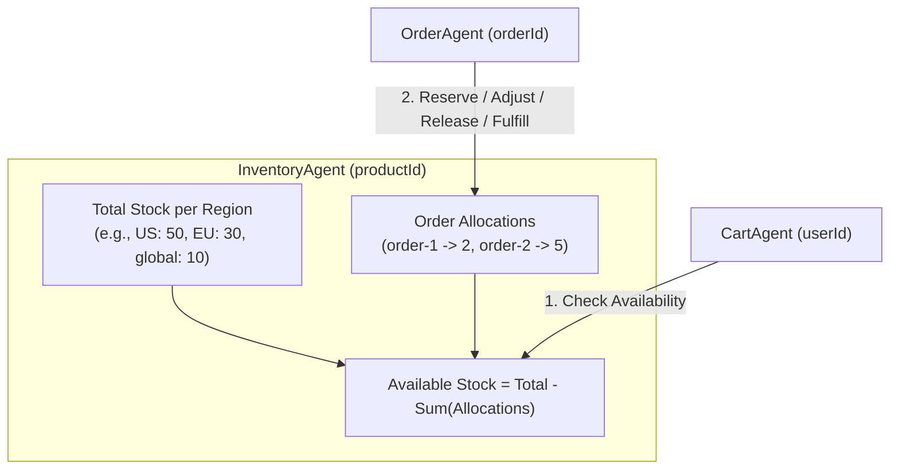
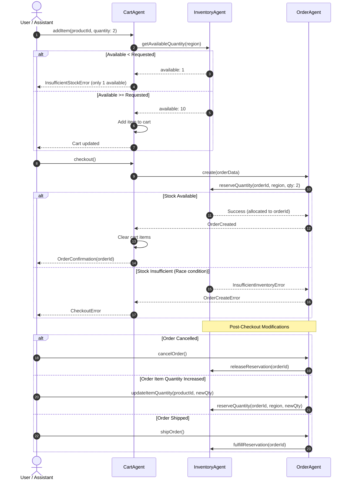

# Feature Implementation Plan: Per-Product Regional Inventory Management

- **Feature ID / Slug**: `product-inventory`
- **Proposed By**: User & Antigravity Pair Programming
- **Date**: 2026-11-02
- **Status**: Pending User Approval

---

## 1. Overview & Goals

This feature introduces durable, region-aware inventory management to the Golem Shopping application. Similar to `PricingAgent`, each product will have its own dedicated durable `InventoryAgent` identified by `productId`, tracking stock quantities across geographic regions (e.g., `"global"`, `"us"`, `"eu"`).

### Core Goals
1. **Per-Product Inventory Agent**:
   - A durable Golem agent (`InventoryAgent`) instantiated per `productId`.
   - Stores stock levels partitioned by `region`.
   - Tracks allocations/reservations explicitly per `orderId`.
2. **Cart Integration & Buying Experience**:
   - Prevent adding items or updating quantities in the cart if the requested quantity exceeds available stock.
   - Transparent error handling (`insufficient-stock`) that informs the customer (and the AI shopping assistant) of available stock.
3. **Checkout & Order Lifecycle Integration**:
   - **Reservation at Checkout**: When an order is placed (`OrderAgent.create`), inventory is reserved per order ID with compensating rollback if any item in the order lacks sufficient stock.
   - **Post-Checkout Order Modifications**:
     - `addItem`: reserves stock for the newly added item.
     - `updateItemQuantity`: adjusts the allocated quantity up or down for the order.
     - `removeItem`: releases the reservation for that product back to available stock.
     - `cancelOrder`: releases all reserved inventory for the order.
     - `shipOrder`: fulfills the reservation (deducts from base stock and clears the order allocation).
4. **Data Import & Seeding**:
   - Create `data/fixtures/tech_inventory.csv` seeding initial stock of 10 items for each product in the `"global"` region.
   - Update `data/import.yaml` and `data/README.md` to import inventory during drill runs.
5. **Documentation & Architecture Diagram**:
   - Update `architecture.puml` with `InventoryAgent`, gateway route `/v1/inventory/**`, and agent-to-agent interactions.
   - Update `README.md` to document the new `InventoryAgent`.
6. **AI Shopping Assistant Integration**:
   - Expose inventory availability in product search and details.
   - Equip the shopping assistant with clear stock validation feedback when adding items to the cart.

---

## 2. Architecture & Design

### 2.1 Inventory State & Quantity Math

For a given product and region:
- **Total Stock ($Q_{total}$)**: Physical or base stock allocated to that region.
- **Allocations ($A_{order}$)**: Quantity currently reserved by active orders (`orderId -> quantity`).
- **Allocated Stock ($Q_{allocated}$)**: $\sum_{\text{orders}} A_{\text{order}}$.
- **Available Stock ($Q_{available}$)**: $\max(0, Q_{total} - Q_{allocated})$.



### 2.2 Order & Cart Lifecycle Sequence



---

## 3. Detailed Agent & Method Specifications

### 3.1 `InventoryAgent` (`src/agents/inventory/`)

- **Agent Name**: `InventoryAgent`
- **ID**: `{ id: Schema.String }` (`productId`)
- **HTTP Mount**: `/v1/inventory/{id}`
- **State**:
  ```typescript
  interface InventoryAgentState {
    readonly productId: string;
    readonly inventory: Inventory | null;
  }
  ```
- **Schemas**:
  - `InventoryItem`: `{ region: Schema.String, totalQuantity: Schema.Number }`
  - `OrderAllocation`: `{ orderId: Schema.String, region: Schema.String, quantity: Schema.Number, updatedAt: Schema.DateTimeUtcFromString }`
  - `Inventory`: `{ productId: Schema.String, items: Schema.Array(InventoryItem), allocations: Schema.Array(OrderAllocation), createdAt: Schema.DateTimeUtcFromString, updatedAt: Schema.DateTimeUtcFromString }`
  - `Availability`: `{ productId: Schema.String, region: Schema.String, availableQuantity: Schema.Number, totalQuantity: Schema.Number, allocatedQuantity: Schema.Number }`
- **Errors**:
  - `InsufficientInventoryError`: `{ _tag: "insufficient-inventory", message: string, productId: string, region: string, requested: number, available: number }`
  - `InventoryNotFoundError`: `{ _tag: "inventory-not-found", message: string, productId: string }`

- **Methods**:
  1. `initializeInventory({ items: InventoryItem[] })`: Sets initial regional stock.
  2. `updateInventory({ items: InventoryItem[] })`: Restocks or updates regional stock levels (merges with existing).
  3. `get()`: Read-only query returning the full `Inventory` record.
  4. `getAvailableQuantity({ region: string })`: Read-only query calculating $Q_{available}$, $Q_{total}$, and $Q_{allocated}$.
  5. `reserveQuantity({ orderId: string, region: string, quantity: number })`:
     - If `allocations[orderId]` already exists with quantity $Q_{prev}$, the change is $\Delta = Q_{new} - Q_{prev}$.
     - Checks if $Q_{available} \ge \Delta$. If valid, updates or inserts the order allocation.
  6. `releaseReservation({ orderId: string })`:
     - Removes the allocation for `orderId`, restoring available stock.
  7. `fulfillReservation({ orderId: string })`:
     - Decrements `totalQuantity` by the allocated amount for that order's region and removes the allocation (order has shipped).

### 3.2 `CartAgent` Changes

- **Add to Cart & Update Quantity**:
  - `addItem` and `updateItemQuantity` query `InventoryAgent.getAvailableQuantity({ region })`.
  - Determines region from cart's `shippingAddress.stateOrRegion` or fallback `INVENTORY_REGION_DEFAULT` (`"global"`).
  - If requested quantity > available quantity, returns `InsufficientStockError`.
- **Checkout**:
  - Delegates order creation to `OrderAgent.create`, propagating inventory reservation errors.

### 3.3 `OrderAgent` Changes

- **Order Creation (`create`)**:
  - Sequentially or concurrently reserves stock via `InventoryAgent.reserveQuantity` for each line item.
  - If any item fails reservation, compensating `releaseReservation` is invoked for all already-reserved items in the transaction.
- **Order Modifications (`addItem`, `updateItemQuantity`, `removeItem`)**:
  - `addItem`: reserves stock for the item under `orderId`.
  - `updateItemQuantity`: calls `reserveQuantity` with the new quantity, adjusting the allocation.
  - `removeItem`: releases the reservation for that item under `orderId`.
- **Status Transitions**:
  - `cancelOrder`: releases all reserved allocations for this `orderId`.
  - `shipOrder`: calls `fulfillReservation` for all items, finalizing the stock deduction.

### 3.4 `ProductSearchAgent` & Shopping Assistant

- `ProductSearchAgent`:
  - Optional enrichment helper `attachInventoryToProducts` or field in `ProductWithPrice` to show availability status (`inStock: boolean`, `availableQuantity: number`).
- `ShoppingAssistant`:
  - Auto-generated tools seamlessly pick up `InsufficientStockError` and explain to the user when an item is out of stock or low in inventory.
  - Optional `check_inventory` tool for checking regional stock.

### 3.5 Sample Data & Drill Import

- **`data/fixtures/tech_inventory.csv`**:
  CSV containing `productId,body` with `{"items":[{"region":"global","totalQuantity":10}]}` for each product.
- **`data/import.yaml`**:
  Adds step `Create tech inventory, index {{ index }}` targeting `/v1/inventory/{{ item.productId }}` via `POST`.
- **`data/README.md`**:
  Documents the new inventory fixtures and import step.

### 3.6 Architecture Diagram & Root Documentation

- **`architecture.puml`**:
  - Add `[Inventory Agent] as inventory #D5F5E3` (or distinct color).
  - Add routing in API Gateway notes: `• /v1/inventory/** → Inventory Agent`.
  - Add communication edges:
    - `gateway --> inventory : "RPC\nInventory API"`
    - `cart --> inventory : "RPC\nCheck inventory"`
    - `order --> inventory : "RPC\nReserve / adjust / release inventory"`
    - `product_search --> inventory : "RPC\nGet stock status"`
- **`README.md`**:
  - Add `Inventory Agent` description under `### Agents`.

---

## 4. File-by-File Changes

| Status | File Path | Description |
| :--- | :--- | :--- |
| `[NEW]` | `src/agents/inventory/inventory-schema.ts` | Schemas for `InventoryItem`, `OrderAllocation`, `Inventory`, `Availability`, and errors. |
| `[NEW]` | `src/agents/inventory/inventory-agent.ts` | Durable `InventoryAgent` definition and implementation. |
| `[NEW]` | `src/agents/inventory/index.ts` | Barrel export for `InventoryAgent` and schemas. |
| `[MODIFY]` | `src/common/models.ts` | Export `INVENTORY_REGION_DEFAULT = "global"`. |
| `[MODIFY]` | `src/agents/cart/cart-schema.ts` | Add `InsufficientStockError` to `AddItemError`, `UpdateItemQuantityError`, and `CheckoutError`. |
| `[MODIFY]` | `src/agents/cart/cart-agent.ts` | Validate stock with `InventoryAgent` in `addItem` and `updateItemQuantity`. |
| `[MODIFY]` | `src/agents/order/order-schema.ts` | Add `InsufficientInventoryError` to `InitOrderError`, `AddItemError`, `UpdateItemQuantityError`. |
| `[MODIFY]` | `src/agents/order/order-agent.ts` | Coordinate reservations, adjustments, releases, and fulfillment with `InventoryAgent`. |
| `[MODIFY]` | `src/agents/product-search/product-search-agent.ts` | Enrich product search results with regional inventory availability. |
| `[MODIFY]` | `src/main.ts` | Register and export `InventoryAgent`. |
| `[NEW]` | `data/fixtures/tech_inventory.csv` | Sample inventory data setting 10 units for all products in `"global"`. |
| `[MODIFY]` | `data/import.yaml` | Add inventory import step using `tech_inventory.csv`. |
| `[MODIFY]` | `data/README.md` | Document inventory fixtures and import. |
| `[MODIFY]` | `architecture.puml` | Add `Inventory Agent` and relationships to PlantUML diagram. |
| `[MODIFY]` | `README.md` | Document `Inventory Agent` in application overview and components. |
| `[NEW]` | `test/inventory-agent.test.ts` | Unit & integration tests for inventory reservations, release, and over-allocation prevention. |

---

## 5. Verification Plan

### Automated Checks
1. **Formatting**:
   ```bash
   npm run format:check
   ```
2. **Type Checking**:
   ```bash
   npm run typecheck
   ```
3. **Linting**:
   ```bash
   npm run lint
   ```
4. **Unit Tests**:
   ```bash
   npm test
   ```
5. **Golem Build**:
   ```bash
   npm run build # golem build --yes
   ```

### Manual & Flow Verification
- Verify `InventoryAgent` initializes regional quantities (10 for `"global"`).
- Attempt to add 15 items to `CartAgent` $\rightarrow$ Expect `insufficient-stock` error with `available: 10`.
- Add 5 items to `CartAgent` and checkout $\rightarrow$ Expect `OrderAgent` created and `InventoryAgent` shows 5 allocated, 5 available.
- Modify order item quantity from 5 to 8 $\rightarrow$ Expect allocated 8, available 2.
- Cancel order $\rightarrow$ Expect allocations released, available returns to 10.
- Ship order $\rightarrow$ Expect total stock reduced from 10 to 2, allocations cleared.

---

## 6. Risks & Considerations

1. **Race Conditions during Checkout**:
   - Multiple users may have the last item in their carts simultaneously because carts only do soft checks.
   - At checkout time, hard reservation in `OrderAgent.create` guarantees that only the first successful checkout claims the stock, while subsequent checkouts receive an explicit out-of-stock failure.
2. **Abandoned Orders / Cart Expiration**:
   - Because reservations are tied to `orderId` created at checkout (rather than ephemeral cart sessions), inventory is never tied up indefinitely by abandoned browser tabs.
3. **Partial Order Failures**:
   - If an order with multiple items fails to reserve stock on item #3, items #1 and #2 must be compensated and released immediately. This is implemented via an Effect transactional rollback pattern.
