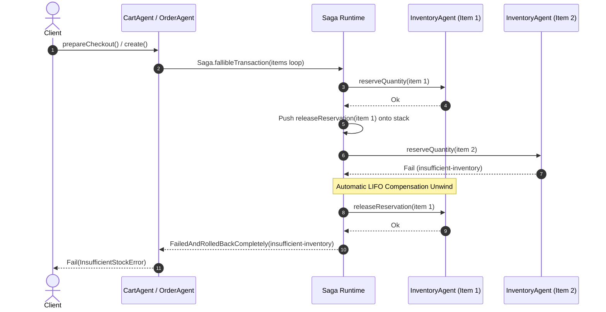

# Feature Plan: Inventory Reservation Sagas & Checkout Lifecycle Fix (Recommendation 1.4)

## Overview & Goals
In an agent-based e-commerce application, distributed operations across autonomous agents (`CartAgent`, `OrderAgent`, `InventoryAgent`) require strict transactional consistency and proper lifecycle alignment.

This feature addresses two core issues in the checkout and order lifecycle:
1. **Multi-Item Reservation Rollback**:
   Currently, `CartAgent.prepareCheckout` and `OrderAgent.create` implement brittle, copy-pasted manual rollback logic:
   - They maintain a mutable array `reservedProductIds: string[] = []`.
   - On every loop iteration, they attach an `Effect.tapError` callback that loops through previously reserved products to trigger `releaseReservation`.
   - We replace this with a reusable **`reserveItemsSaga`** using `@golemcloud/effect-golem`'s `Saga` module (`Saga.fallibleTransaction`, `Saga.withFallibleCompensation`), ensuring automatic, declarative LIFO rollback of all previously reserved items whenever any item fails midway.
2. **Checkout Lifecycle Alignment (`confirmCheckout`)**:
   Currently, `CartAgent.confirmCheckout` incorrectly calls `invClient.fulfillReservation` immediately upon order creation.
   - In the business domain, reservations represent holds (`OrderAllocation`). Fulfillments permanently deduct physical stock from `totalQuantity` and delete allocations.
   - Per `InventoryAgent` method specification, fulfillment should **only** occur upon physical dispatch (`OrderAgent.shipOrder`).
   - Calling fulfillment at `confirmCheckout` prematurely deletes the allocation, which prevents stock restoration if the order is subsequently cancelled via `OrderAgent.cancelOrder`.
   - We fix `CartAgent.confirmCheckout` by removing the premature `fulfillReservation` loop, letting `OrderAgent.create` hold the confirmed reservation until `OrderAgent.shipOrder` fulfills it.

---

## User Review Required

> [!IMPORTANT]
> **Key Decisions & Workflow Alignment**:
> 1. **Inventory Reservation Lifecycle**:
>    - `CartAgent.prepareCheckout`: Calls `reserveItemsSaga` with temporary expiration (`expiresAt: now + 10m`).
>    - `CartAgent.confirmCheckout`: Calls `OrderAgent.create`, which calls `reserveItemsSaga` with permanent hold (`expiresAt: undefined`).
>    - `OrderAgent.shipOrder`: Calls `invClient.fulfillReservation` to permanently deduct stock upon shipping.
>    - `OrderAgent.cancelOrder`: Calls `invClient.releaseReservation` to return held stock back to available inventory.
> 2. **Multi-Item Saga Scope**:
>    - `reserveItemsSaga` handles an entire array of items in a single `Saga.fallibleTransaction`.
>    - If item $k$ fails (`insufficient-inventory` or `inventory-not-found`), items $1 \dots k-1$ are automatically released in reverse order.

---

## Architecture & Design

### 1. Multi-Item Reservation Saga Sequence Diagram



---

### 2. Core Modules and Utilities

#### A. Reusable Multi-Item Reservation Saga (`src/agents/inventory/inventory-saga.ts`)
Encapsulates reserving an array of items with automatic compensation:
```typescript
import { DateTime, Effect } from "effect";
import { Saga } from "@golemcloud/effect-golem";
import { CartItem } from "../cart/cart-schema.js";
import { OrderItem } from "../order/order-schema.js";
import { InventoryAgent } from "./inventory-agent.js";
import { orDieRpc } from "../../common/index.js";

export type ReservationItem = Pick<CartItem | OrderItem, "productId" | "quantity">;

export const reserveItemsSaga = ({
  orderId,
  region,
  items,
  expiresAt,
}: {
  readonly orderId: string;
  readonly region: string;
  readonly items: ReadonlyArray<ReservationItem>;
  readonly expiresAt?: DateTime.DateTimeUtc;
}) =>
  Saga.fallibleTransaction(
    Effect.forEach(
      items,
      (item) =>
        Effect.gen(function* () {
          const invClient = yield* InventoryAgent.client
            .get({ id: item.productId })
            .pipe(Effect.orDie);

          yield* Saga.withFallibleCompensation(
            invClient
              .reserveQuantity({
                orderId,
                region,
                quantity: item.quantity,
                expiresAt,
              })
              .pipe(
                Effect.catchTag("inventory-not-found", (err) =>
                  Effect.fail({
                    _tag: "insufficient-inventory" as const,
                    message: err.message,
                    productId: item.productId,
                    region,
                    requested: item.quantity,
                    available: 0,
                  }),
                ),
                orDieRpc,
              ),
            () => invClient.releaseReservation.trigger({ orderId }).pipe(Effect.asVoid),
          );
        }),
      { discard: true },
    ),
  ).pipe(
    Effect.catchTag("NestedSagaError", (err) => Effect.die(err)),
    Effect.catchTag("FailedAndRolledBackCompletely", (failure) =>
      Effect.fail(failure.error),
    ),
    Effect.catchTag("FailedAndRolledBackPartially", (failure) =>
      Effect.logWarning(
        `Reservation saga rolled back partially. Error: ${String(failure.compensationError)}`,
      ).pipe(Effect.andThen(Effect.fail(failure.error))),
    ),
  );
```

#### B. Fixing `CartAgent.confirmCheckout` (`src/agents/cart/cart-agent.ts`)
Remove the redundant `fulfillReservation` loop. The method becomes clean and focused:
```typescript
confirmCheckout: ({ orderId }) =>
  Effect.scoped(
    Effect.gen(function* () {
      const current = yield* getOrCreateCart;
      const now = yield* getCurrentDatetime;

      if (!current.draft) {
        return yield* Effect.fail({
          _tag: "no-active-draft" as const,
          message: "No active checkout draft found. Please prepare checkout first.",
        });
      }

      if (current.draft.orderId !== orderId) {
        return yield* Effect.fail({
          _tag: "order-mismatch" as const,
          message: `Requested orderId ${orderId} does not match active draft ${current.draft.orderId}`,
        });
      }

      if (DateTime.toEpochMillis(current.draft.expiresAt) <= DateTime.toEpochMillis(now)) {
        yield* Ref.update(state, (curr) => ({
          ...curr,
          cart: curr.cart ? { ...curr.cart, draft: null, updatedAt: now } : null,
        }));
        return yield* Effect.fail({
          _tag: "reservation-expired" as const,
          message: "The checkout reservation has expired. Please prepare checkout again.",
        });
      }

      const orderClient = yield* OrderAgent.client.get({ id: orderId }).pipe(Effect.orDie);
      yield* orderClient
        .create({
          order: {
            userId: current.userId,
            items: current.items,
            email: current.email!,
            billingAddress: current.billingAddress!,
            shippingAddress: current.shippingAddress ?? undefined,
            total: current.total,
            currency: current.currency,
            updatedAt: now,
          },
        })
        .pipe(
          Effect.catchTag("insufficient-inventory", (invErr) =>
            Effect.fail({
              _tag: "insufficient-stock" as const,
              message: invErr.message,
              productId: invErr.productId,
              region: invErr.region,
              requested: invErr.requested,
              available: invErr.available,
            }),
          ),
          Effect.catch((err) =>
            Effect.fail({
              _tag: "order-create" as const,
              message: "message" in err ? String(err.message) : "Order creation failed",
            }),
          ),
        );

      // Inventory fulfillment is deferred to OrderAgent.shipOrder.
      // Finalize cart state:
      const updatedCart: Cart = {
        ...current,
        items: [],
        total: 0,
        draft: null,
        previousOrderIds: [...current.previousOrderIds, orderId],
        updatedAt: now,
      };

      yield* Ref.update(state, (curr) => ({ ...curr, cart: updatedCart }));

      return {
        orderId,
        userId: current.userId,
        items: current.items,
        total: current.total,
        currency: current.currency,
        confirmedAt: now,
      };
    }),
  ),
```

#### C. `CartAgent.prepareCheckout` and `OrderAgent.create` Simplification
Both methods delegate to `reserveItemsSaga`:
- `CartAgent.prepareCheckout`:
  ```typescript
  yield* reserveItemsSaga({
    orderId,
    region,
    items: current.items,
    expiresAt,
  }).pipe(
    Effect.catchTag("insufficient-inventory", (err) =>
      Effect.fail({
        _tag: "insufficient-stock" as const,
        message: err.message,
        productId: err.productId,
        region: err.region,
        requested: err.requested,
        available: err.available,
      }),
    ),
  );
  ```
- `OrderAgent.create`:
  ```typescript
  yield* reserveItemsSaga({
    orderId: current.orderId,
    region,
    items: order.items,
    expiresAt: undefined,
  });
  ```
  Completely eliminates the 40 lines of duplicate manual array tracking and nested error callbacks.

---

## File-by-File Changes

| Status | File | Description |
| :--- | :--- | :--- |
| `[NEW]` | `src/agents/inventory/inventory-saga.ts` | Shared `reserveItemsSaga` helper using `Saga.fallibleTransaction` and `Saga.withFallibleCompensation`. |
| `[MODIFY]` | `src/agents/cart/cart-agent.ts` | 1) Refactor `prepareCheckout` to use `reserveItemsSaga`.<br>2) Fix `confirmCheckout` by removing premature `fulfillReservation` loop. |
| `[MODIFY]` | `src/agents/order/order-agent.ts` | Refactor `create` to use `reserveItemsSaga`, eliminating 40 lines of manual rollback code. |
| `[NEW]` | `test/saga-transactions.test.ts` | Tests validating multi-item reservation saga, automatic reverse-order compensation on partial failure, and checkout confirmation behavior. |

---

## Verification Plan

### Automated Checks
1. **Format Check**:
   ```bash
   npm run format:check
   ```
2. **Type Check**:
   ```bash
   npx tsc --noEmit
   ```
3. **Linter**:
   ```bash
   npm run lint
   ```
4. **Unit Tests**:
   ```bash
   npm test
   ```
   Runs existing 70 tests plus new `test/saga-transactions.test.ts`.
5. **Golem Build**:
   ```bash
   /Users/coon/opt/golem/bin/golem build --yes
   ```
   Validates WASM component bundling, Rollup exports, and preinitialization.

---

## Risks & Open Questions
1. **Idempotent Release**: Calling `releaseReservation` multiple times or after an allocation expired is a safe no-op in `InventoryAgent`.
2. **Shipping & Cancellation Lifecycle**: With `fulfillReservation` removed from `confirmCheckout`, confirmed orders in `"new"` status preserve their inventory allocations until `shipOrder` fulfills them or `cancelOrder` releases them.
