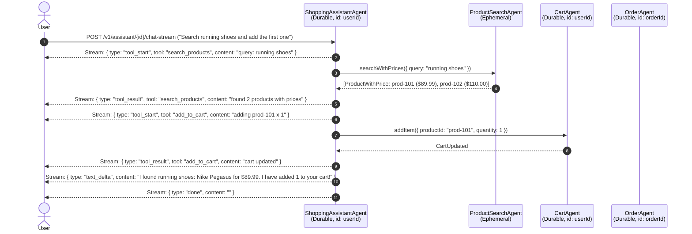

# Feature Plan: Shopping Assistant Full Experience with Domain Agent Tools & Streaming

- **Feature ID / Slug**: `shopping-assistant-full-experience`
- **Date**: 2026-10-30
- **Status**: Completed <!-- Draft | Approved | In Progress | Completed -->

---

## 1. Overview & Goals

Revisit and upgrade the `ShoppingAssistantAgent` into a full-lifecycle, conversational shopping assistant powered by **real-time streaming** and autonomous **tool calling**.

Following domain-driven design, **all core capabilities are first-class Golem Agent methods** implemented directly on the appropriate domain agents (`CartAgent`, `ProductSearchAgent`, `OrderAgent`). The Shopping Assistant uses these agent methods as tools via 1:1 typed RPC bindings, with zero duplicated business logic.

For the internal agent engine, we start with the **standard Effect AI / Effect HTTP** architecture (leveraging `effect/ai`, `@golemcloud/effect-golem`, and `FetchHttpClient`), while documenting **`@earendil-works/pi-ai`** as a potential next step / future improvement path aligned with the latest Golem demos.

### Core Capabilities

1. **Domain Agent Enhancements**:
   - **`CartAgent`**:
     - `getSavedContactInfo`: Read-only inspection of the user's latest order addresses (shipping/billing) and email.
     - `applySavedContactInfo`: Pre-fills the active cart with saved contact details from the previous order in one call.
     - `getOrderHistory`: Resolves `previousOrderIds` and returns the user's past `Order` list, with an **optional `limit` parameter** returning most recent orders first.
     - Existing address/email methods (`updateShippingAddress`, `updateBillingAddress`, `updateEmail`) directly accessible.
   - **`ProductSearchAgent`**:
     - `ProductWithPrice` schema combining product specs with live `Pricing`.
     - `searchWithPrices`: Catalog search returning products with current pricing attached.
     - `getByIdsWithPrices`: Resolves product IDs with pricing attached (powering both multi-item lookups and single-item `get_product_details`).
2. **Conversational Assistant & Streaming**:
   - Durable multi-turn conversation history per user (`userId`).
   - `chat`: Synchronous request/response endpoint (`POST /v1/assistant/{id}/chat`).
   - `chatStream`: Real-time streaming endpoint via `WitTypes.AgentStream(ChatChunk)` emitting tool-calling milestones and token deltas (`POST /v1/assistant/{id}/chat-stream`).
   - `getHistory` & `clearHistory`: Conversation history inspection and reset.
   - Retained recommendation methods (`getRecommendedItems`, `recommendItems`).
3. **1:1 Tool Mapping**:
   - Every tool invoked by the assistant maps directly to an underlying Golem Agent method.
   - Automatic `userId` binding so the LLM only generates business parameters.
4. **Complete Checkout Lifecycle**:
   - **Returning Customers**: Assistant checks `get_saved_contact_info`, confirms with the user, and calls `apply_saved_contact_info` ➡️ `checkout_cart`.
   - **First-Time Customers / Custom Addresses**: If `get_saved_contact_info` returns `null` or if the user requests a custom address, the assistant uses `set_shipping_address`, `set_billing_address`, and `set_email` to prepare the cart before checkout.
5. **Agent Engine Strategy**:
   - **Phase 1 (Initial)**: Standard Effect AI / Effect HTTP streaming tool loop.
   - **Potential Next Step**: Benchmark and adapt `@earendil-works/pi-ai` as an alternative multi-provider runtime.

---

## 2. Architecture & Technical Design

### Agent Architecture & Tool Call Flow



---

### Domain Agent Enhancements

#### 1. `CartAgent` Enhancements (`src/agents/cart/`)

* **New Schema (`SavedContactInfo`)**:
  ```typescript
  export class SavedContactInfo extends Schema.Class<SavedContactInfo>("SavedContactInfo")({
    shippingAddress: Schema.NullOr(Address),
    billingAddress: Schema.NullOr(Address),
    email: Schema.NullOr(Schema.String),
    sourceOrderId: Schema.NullOr(Schema.String),
  }) {}
  ```
* **New Methods**:
  * `getSavedContactInfo`:
    - Method: `input: {}`, `success: Schema.NullOr(SavedContactInfo)`, `readOnly: true`
    - HTTP: `GET /v1/cart/{id}/saved-contact`
    - Behavior: If `previousOrderIds` has entries, fetches the latest order from `OrderAgent` and returns its `shippingAddress`, `billingAddress`, `email`, and `sourceOrderId`.
  * `applySavedContactInfo`:
    - Method: `input: {}`, `success: CartUpdated`, `error: UpdateAddressError`
    - HTTP: `POST /v1/cart/{id}/use-saved-contact`
    - Behavior: Fetches the latest order, applies its addresses and email onto the current cart state, and recalculates totals.
  * `getOrderHistory`:
    - Method: `input: { limit: Schema.optional(Schema.Number) }`, `success: Schema.Array(Order)`, `readOnly: true`
    - HTTP: `GET /v1/cart/{id}/orders?limit={limit}`
    - Behavior: Takes up to `limit` most recent order IDs from `previousOrderIds` (most recent first, default 10), queries them in parallel via `OrderAgent.get`, and returns the orders.

---

#### 2. `ProductSearchAgent` Enhancements (`src/agents/product-search/`)

* **New Schema (`ProductWithPrice`)**:
  ```typescript
  export class ProductWithPrice extends Schema.Class<ProductWithPrice>("ProductWithPrice")({
    productId: Schema.String,
    name: Schema.String,
    brand: Schema.String,
    description: Schema.String,
    tags: Schema.Array(Schema.String),
    price: Schema.NullOr(PricingItem),
    createdAt: Datetime.Datetime,
    updatedAt: Datetime.Datetime,
  }) {}
  ```
* **New Methods**:
  * `searchWithPrices`:
    - Method: `input: { query: Schema.String, currency: Schema.optional(Schema.String) }`, `success: Schema.Array(ProductWithPrice)`
    - HTTP: `GET /v1/product/search-with-prices?query={query}&currency={currency}`
    - Behavior: Performs the keyword/brand/tag search across products, then parallel-fetches active item pricing from `PricingAgent` via `pricingClient.getPrice({ currency: currency ?? CURRENCY, region: PRICING_REGION_DEFAULT })` for matched products.
  * `getByIdsWithPrices`:
    - Method: `input: { ids: Schema.String, currency: Schema.optional(Schema.String) }`, `success: Schema.Array(ProductWithPrice)`
    - HTTP: `GET /v1/product/with-prices?ids={ids}&currency={currency}`
    - Behavior: Fetches products by comma-separated IDs and bundles their item pricing via `pricingClient.getPrice({ currency: currency ?? CURRENCY, region: PRICING_REGION_DEFAULT })`. (Serves both multi-product lookups and single-product `get_product_details`).
    *(Note: As an ephemeral agent, `ProductSearchAgent` methods do not use the `readOnly` marker per Golem type discovery rules).*

---

### Complete Shopping Assistant Tool Suite

Every tool maps directly to a Golem agent method:

| Category | Tool Name | Target Agent & Method | Description |
|---|---|---|---|
| **Catalog** | `search_products` | `ProductSearchAgent.searchWithPrices({ query })` | Searches catalog with live prices included. |
| **Catalog** | `get_product_details` | `ProductSearchAgent.getByIdsWithPrices({ ids: productId })` | Gets product specs and pricing for a product ID. |
| **Cart** | `get_cart` | `CartAgent.get({})` | Gets current cart items, counts, and subtotal. |
| **Cart** | `add_to_cart` | `CartAgent.addItem({ productId, quantity })` | Adds item to cart. |
| **Cart** | `update_cart_quantity` | `CartAgent.updateItemQuantity({ productId, quantity })` | Updates quantity in cart. |
| **Cart** | `remove_from_cart` | `CartAgent.removeItem({ productId })` | Removes item from cart. |
| **Cart** | `clear_cart` | `CartAgent.clear({})` | Empties cart. |
| **Checkout Profile** | `get_saved_contact_info` | `CartAgent.getSavedContactInfo({})` | Reads saved shipping/billing/email from latest order. |
| **Checkout Profile** | `apply_saved_contact_info` | `CartAgent.applySavedContactInfo({})` | Applies saved shipping/billing/email onto active cart. |
| **Checkout Profile** | `set_shipping_address` | `CartAgent.updateShippingAddress(...)` | Manually sets shipping address on cart. |
| **Checkout Profile** | `set_billing_address` | `CartAgent.updateBillingAddress(...)` | Manually sets billing address on cart. |
| **Checkout Profile** | `set_email` | `CartAgent.updateEmail({ email })` | Sets contact email on cart for receipt. |
| **Checkout** | `checkout_cart` | `CartAgent.checkout({})` | Places order and returns confirmation. |
| **Orders** | `get_order_history` | `CartAgent.getOrderHistory({ limit? })` | Gets list of user's past orders (most recent first, optional limit). |
| **Orders** | `get_order_details` | `OrderAgent.get({})` | Gets details for a specific order. |

---

### Shopping Assistant Schemas and Endpoints

#### Data Schemas (`src/agents/shopping-assistant/shopping-assistant-schema.ts`):

```typescript
export const ChatRole = Schema.Literal("system", "user", "assistant", "tool");

export class ToolCallRecord extends Schema.Class<ToolCallRecord>("ToolCallRecord")({
  id: Schema.String,
  toolName: Schema.String,
  arguments: Schema.String,
  result: Schema.String,
}) {}

export class ChatMessage extends Schema.Class<ChatMessage>("ChatMessage")({
  role: ChatRole,
  content: Schema.String,
  toolCalls: Schema.optional(Schema.Array(ToolCallRecord)),
  timestamp: Schema.String,
}) {}

export const ChatChunkType = Schema.Literal("tool_start", "tool_result", "text_delta", "done", "error");

export class ChatChunk extends Schema.Class<ChatChunk>("ChatChunk")({
  type: ChatChunkType,
  content: Schema.String,
  tool: Schema.optional(Schema.String),
}) {}

export class ChatRequest extends Schema.Class<ChatRequest>("ChatRequest")({
  message: Schema.String,
}) {}

export class ChatResponse extends Schema.Class<ChatResponse>("ChatResponse")({
  reply: Schema.String,
  toolCallsUsed: Schema.Array(ToolCallRecord),
}) {}
```

#### HTTP Endpoints in `ShoppingAssistantDefinition`:

- `POST /v1/assistant/{id}/chat`: Synchronous request/response (`{ reply, toolCallsUsed }`).
- `POST /v1/assistant/{id}/chat-stream`: Real-time streaming via `WitTypes.AgentStream(ChatChunk)`.
- `GET /v1/assistant/{id}/history`: Returns complete list of `ChatMessage` objects in current session.
- `POST /v1/assistant/{id}/clear-history`: Resets conversation message history.
- `GET /v1/assistant/{id}/recommended-items`: Preserved existing endpoint.
- `POST /v1/assistant/{id}/recommend-items`: Preserved existing endpoint.

---

### Agent Engine & Evolution Roadmap

1. **Phase 1: Standard Effect AI Engine**
   - Implemented using native Effect HTTP / `FetchHttpClient` calling OpenRouter / OpenAI compatible endpoint.
   - Dispatches tool calls iteratively (capped at 5 steps per turn).
   - Emits real-time chunks over Effect `Stream` matching `WitTypes.AgentStream(ChatChunk)`.
   - Guarantees 100% QuickJS WebAssembly compatibility and durable execution.
2. **Phase 2 (Potential Improvement / Benchmark)**:
   - Experiment with `@earendil-works/pi-ai` in a separate branch or component evaluation.
   - Benchmark bundling footprint and QuickJS compatibility against the native Effect implementation.

---

## 3. File-by-File Changes

| Status | File Path | Description |
|---|---|---|
| `[MODIFY]` | `src/agents/cart/cart-schema.ts` | Add `SavedContactInfo` schema and export it. |
| `[MODIFY]` | `src/agents/cart/cart-definition.ts` | Add `getSavedContactInfo`, `applySavedContactInfo`, and `getOrderHistory` (with `limit`) methods to `CartAgentDefinition`. |
| `[MODIFY]` | `src/agents/cart/cart-agent.ts` | Implement `getSavedContactInfo`, `applySavedContactInfo`, and `getOrderHistory` in `CartAgent`. |
| `[MODIFY]` | `src/agents/cart/index.ts` | Re-export new cart schemas. |
| `[MODIFY]` | `src/agents/product-search/product-search-agent.ts` | Add `ProductWithPrice` schema, implement `searchWithPrices` and `getByIdsWithPrices`. |
| `[MODIFY]` | `src/agents/product-search/index.ts` | Re-export `ProductWithPrice`. |
| `[MODIFY]` | `src/agents/shopping-assistant/shopping-assistant-schema.ts` | Add `ChatMessage`, `ToolCallRecord`, `ChatChunk`, `ChatRequest`, `ChatResponse`. |
| `[NEW]` | `src/agents/shopping-assistant/shopping-assistant-tools.ts` | Define tools mapping 1:1 to agent methods with automatic `userId` context injection. |
| `[NEW]` | `src/agents/shopping-assistant/shopping-assistant-loop.ts` | Agentic loop runner with OpenAI/OpenRouter streaming protocol, dispatching tools and emitting `ChatChunk` events. |
| `[NEW]` | `src/agents/shopping-assistant/shopping-assistant-recommendations.ts` | Order history item reduction, prompt payload generation, LLM request execution, and parsing for `recommendItems`. |
| `[MODIFY]` | `src/agents/shopping-assistant/shopping-assistant-definition.ts` | Add `chat`, `chatStream` (with `WitTypes.AgentStream(ChatChunk)`), `getHistory`, `clearHistory` methods with HTTP annotations. |
| `[MODIFY]` | `src/agents/shopping-assistant/shopping-assistant-agent.ts` | Implement new methods in `ShoppingAssistantAgent`, maintain durable message state in `Ref`, wire tools to agent loop. |
| `[MODIFY]` | `src/agents/shopping-assistant/index.ts` | Re-export new assistant types. |
| `[NEW]` | `test/shopping-assistant-tools.test.ts` | Unit tests for shopping assistant tools, schema validation, and tool execution. |

---

## 4. Verification Plan

### Automated Checks

1. **Prettier Formatting**:
   ```bash
   npm run format
   npm run format:check
   ```
2. **TypeScript Compilation**:
   ```bash
   npm run typecheck
   ```
3. **ESLint Verification**:
   ```bash
   npm run lint
   ```
4. **Unit Tests Execution**:
   ```bash
   npm test
   ```
5. **Golem Component Build**:
   ```bash
   npm run build # golem build --yes
   ```
   Ensures Rollup bundle and QuickJS WebAssembly compilation succeed without unresolved dependencies or WASM errors.

---

## 5. Risks & Open Questions

1. **First-Time Users (No Prior Orders)**:
   - For new users who have no prior orders, `getSavedContactInfo` returns `null`, and the assistant uses `set_shipping_address`, `set_billing_address`, and `set_email`.
2. **LLM Provider & Credentials**:
   - The current setup uses OpenRouter via `OPENROUTER_KEY` and model `openrouter/owl-alpha` (or `openai/gpt-4o-mini`).
   - If `OPENROUTER_KEY` is not provided in a test environment, the agent degrades gracefully (e.g., emits a helpful error chunk or prompt to configure keys).
3. **Streaming in Golem WASM**:
   - Using `WitTypes.AgentStream(ChatChunk)` and native Effect `Stream` handles backpressure and lifecycle events cleanly in QuickJS.
4. **Loop Capping**:
   - Tool calling is capped at 5 steps max per turn to avoid runaway loops.
