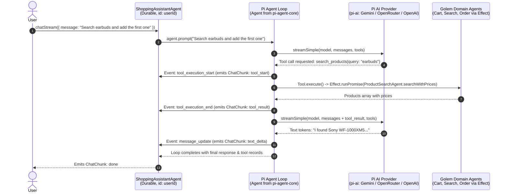

# Feature Plan: Replace Custom Shopping Assistant Loop with Pi Agent

- **Feature ID / Slug**: `shopping-assistant-pi-agent`
- **Date**: 2026-10-31
- **Status**: Completed <!-- Draft | Approved | In Progress | Completed -->

---

## 1. Overview & Goals

The `ShoppingAssistantAgent` currently uses a custom hand-rolled while-loop in `src/agents/shopping-assistant/shopping-assistant-loop.ts` to manage multi-turn chat completions, parse raw OpenAI-compatible tool call payloads, invoke local Effect-based tools, and feed results back to the LLM.

While functional, this custom loop requires manual state accumulation, custom payload marshalling, manual step iteration (`MAX_STEPS`), and custom tool dispatching logic.

This feature replaces the custom LLM tool loop with **Pi Agent** (`@earendil-works/pi-agent-core` and `@earendil-works/pi-ai`), the minimalist, extensible TypeScript agent runtime created by Mario Zechner. Pi Agent natively manages multi-turn agent turns, model routing, event-driven streaming, and tool execution lifecycles while preserving 100% backward compatibility with Golem agent contracts, schemas, and domain agent tools (`CartAgent`, `ProductSearchAgent`, `OrderAgent`).

### Goals

1. **Replace Custom Loop with Pi Agent**:
   - Use `Agent` from `@earendil-works/pi-agent-core` to manage the reasoning and execution loop.
   - Use `@earendil-works/pi-ai` for multi-provider LLM interactions (supporting Google Gemini, OpenRouter, and OpenAI).
2. **Preserve Domain Tooling & Effect Bridge**:
   - Wrap the existing 13 domain tools defined in `shopping-assistant-tool-specs.ts` and `shopping-assistant-tools.ts` into Pi `AgentTool` instances.
   - Execute tools inside Effect fibers (`Effect.runPromise`) to ensure Golem agent durability, RPC semantics, and tracing remain intact.
3. **Preserve Existing Contracts & Streaming Protocol**:
   - Map Pi Agent event subscriptions (`tool_execution_start`, `tool_execution_end`, `message_update`) directly to `ChatChunk` (`tool_start`, `tool_result`, `text_delta`, `done`, `error`).
   - Retain identical return shapes for `chat` (`ChatResponse`) and `chatStream` (`Stream<ChatChunk>`).
4. **Strict Golem WebAssembly / QuickJS Compatibility**:
   - Ensure `@earendil-works/pi-agent-core` and `@earendil-works/pi-ai` bundle cleanly via Rollup into the single ESM WebAssembly component without unsupported Node.js native bindings.

### Non-Goals

- Modifying underlying domain agent contracts (`CartAgent`, `OrderAgent`, `ProductSearchAgent`, `PricingAgent`).
- Changing HTTP API route schemas (`/v1/assistant/{id}/chat`, `/v1/assistant/{id}/chat-stream`).
- Changing the recommendation engine (`shopping-assistant-recommendations.ts`).

---

## 2. Architecture & Technical Design

### Component Architecture & Event Flow



### Key Design Decisions

1. **Pi Agent Integration Layer (`Effect.tryPromise`)**:
   - `Agent.prompt()` is an asynchronous Promise-based API. We wrap the Pi Agent invocation inside `Effect.tryPromise` so it seamlessly integrates into the Effect runtime of `ShoppingAssistantAgent`, properly capturing errors into typed Effect channels.

2. **Tool Adapter (`AssistantToolDefinition` ➡️ `AgentTool`)**:
   - Existing tools have Effect Schema definitions (`shopping-assistant-tool-specs.ts`) and Effect execution logic (`shopping-assistant-tools.ts`).
   - We create an adapter function `toPiAgentTool(toolDef, context)` that maps:
     - `name`: tool name (e.g. `search_products`).
     - `description`: tool description.
     - `parameters`: JSON Schema derived from Effect Schema via `schemaToJsonSchema` (or TypeBox equivalent).
     - `execute`: invokes `Effect.runPromise(toolDef.run(args, context))`.
     - Returns `{ content: [{ type: "text", text: resultString }], details: { summary } }`.

3. **Event Subscription & Chunk Streaming**:
   - Pi Agent provides `agent.subscribe(event => ...)`.
   - We map:
     - `tool_execution_start` ➡️ `{ type: "tool_start", tool: event.toolName, content: `Executing ${event.toolName}...` }`
     - `tool_execution_end` ➡️ `{ type: "tool_result", tool: event.toolName, content: event.details?.summary ?? "Done" }`
     - `message_update` (with `assistantMessageEvent.type === "text_delta"`) ➡️ `{ type: "text_delta", content: delta, tool: "" }`
     - Errors ➡️ `{ type: "error", content: errorMessage, tool: "" }`
     - Completion ➡️ `{ type: "done", content: "", tool: "" }`

4. **Multi-Provider Model Resolution**:
   - Configure `@earendil-works/pi-ai` models based on Golem configuration:
     - If `apiUrl` contains `generativelanguage.googleapis.com` or model is `gemini-*`, wire the Google/Gemini provider.
     - If `apiUrl` contains `openrouter.ai` or model contains `openrouter/`, wire OpenRouter.
     - Otherwise, wire generic OpenAI-compatible provider with custom base URL.
   - Inject custom `fetch` or use the global fetch supported by the Golem QuickJS runtime.

5. **Durable History Preservation**:
   - Golem stores history in `state.messages: readonly ChatMessage[]`.
   - When launching Pi Agent, previous messages are converted into Pi's `AgentMessage[]` format.
   - After the turn completes, the user message and assistant message (with `toolCallsUsed`) are committed back to Golem's durable `Ref<ShoppingAssistantAgentState>`.

---

## 3. Proposed Changes & File Impact

| Action     | File Path                                                                     | Description                                                                 |
| :--------- | :---------------------------------------------------------------------------- | :-------------------------------------------------------------------------- |
| `[MODIFY]` | [`package.json`](../../package.json)                                          | Add `@earendil-works/pi-agent-core`, `@earendil-works/pi-ai`, and `@sinclair/typebox` dependencies |
| `[NEW]`    | [`src/agents/shopping-assistant/shopping-assistant-pi-tools.ts`](../../src/agents/shopping-assistant/shopping-assistant-pi-tools.ts) | Adapter converting Effect-based domain tools into Pi `AgentTool` definitions |
| `[MODIFY]` | [`src/agents/shopping-assistant/shopping-assistant-loop.ts`](../../src/agents/shopping-assistant/shopping-assistant-loop.ts) | Replace custom HTTP while-loop with Pi Agent loop while preserving function signatures |
| `[MODIFY]` | [`src/agents/shopping-assistant/shopping-assistant-agent.ts`](../../src/agents/shopping-assistant/shopping-assistant-agent.ts) | Connect updated Pi agent loop and streaming channels                       |
| `[NEW]`    | [`test/shopping-assistant-pi-loop.test.ts`](../../test/shopping-assistant-pi-loop.test.ts) | Unit tests verifying Pi tool adapter, event streaming, and error handling   |

### Detailed Changes

#### 1. `package.json`
- Add dependencies:
  - `@earendil-works/pi-agent-core`: "^1.4.0" (agent loop and state management)
  - `@earendil-works/pi-ai`: "^1.4.0" (model providers and LLM transport)
  - `@sinclair/typebox`: "^0.34.0" (schema parameter validation used by Pi Agent)

#### 2. `src/agents/shopping-assistant/shopping-assistant-pi-tools.ts`
- Implement `createPiAgentTools(userId: string): AgentTool[]`:
  - Iterates over existing `shoppingAssistantTools` from `shopping-assistant-tools.ts`.
  - Bridges `toolDef.run(args, { userId })` into `execute: async (toolCallId, params, signal, onUpdate)`.
  - Maps tool execution results back to Pi's `{ content: [...], details: { summary } }`.

#### 3. `src/agents/shopping-assistant/shopping-assistant-loop.ts`
- Retain existing exported interfaces: `executeChatTurn`, `executeChatTurnStream`, `ChatTurnResult`.
- Reimplement `executeChatTurn`:
  - Set up Pi AI models registry (`createModels()`) configured with API key and endpoint.
  - Instantiate `Agent` with system prompt, model, converted tools, and prior conversation history.
  - Subscribe to Pi Agent events to collect `chunks`, `accumulatedToolCalls`, and `finalReply`.
  - Execute `agent.prompt(userMessage)` wrapped in `Effect.tryPromise`.
  - Handle rate limits, network retries, and format error messages identically to existing behavior.

#### 4. `test/shopping-assistant-pi-loop.test.ts`
- Verify:
  - Tool conversion properly maps all 13 shopping assistant tools.
  - Parameter validation passes arguments correctly to domain agents.
  - Error scenarios (e.g. missing API key, unrecognized tool, rate limit) produce compliant `ChatChunk` and `ChatResponse` structures.

---

## 4. Verification Plan

### Automated Checks

1. **Code Formatting**:
   ```bash
   npm run format:check
   ```
   Ensures all TypeScript code conforms to Prettier rules. Auto-format with `npm run format`.

2. **Type Checking**:
   ```bash
   npm run typecheck
   ```
   Ensures zero TypeScript compiler errors across `src/` and `test/`.

3. **Linter Verification**:
   ```bash
   npm run lint
   ```
   Ensures zero ESLint errors and no unused imports.

4. **Automated Unit & Integration Tests**:
   ```bash
   npm test
   ```
   Runs tsx tests including `test/error-formatter.test.ts`, `test/product-query-matcher.test.ts`, and the new `test/shopping-assistant-pi-loop.test.ts`.

5. **Golem Component Build**:
   ```bash
   golem build --yes
   ```
   Validates that Rollup bundles the new dependencies into the QuickJS WebAssembly binary cleanly.

### Manual / Integration Verification

1. Start local Golem dev server if available:
   ```bash
   golem server start
   ```
2. Deploy the application:
   ```bash
   golem deploy --environment local
   ```
3. Invoke `chat` and `chatStream` via CLI to verify multi-turn tool calling:
   ```bash
   golem agent invoke ShoppingAssistantAgent test-user chat '{"message": "Search for noise cancelling headphones"}'
   ```

---

## 5. Risks & Open Questions

- **Risk 1: QuickJS / WebAssembly Bundle Compatibility**:
  - *Risk*: `@earendil-works/pi-agent-core` or `@earendil-works/pi-ai` might pull in transitive Node.js dependencies (e.g., `node:fs`, `node:crypto`) that QuickJS does not natively support without polyfills.
  - *Mitigation*: Inspect transitive dependencies upon installation. If specific Node built-ins are required, configure Rollup resolve polyfills or provide lightweight shims.
- **Risk 2: Provider Wire Format Differences**:
  - *Risk*: Gemini OpenAI compatibility endpoint (`generativelanguage.googleapis.com/...`) vs. native Google AI SDK vs. OpenRouter.
  - *Mitigation*: `@earendil-works/pi-ai` natively abstracts OpenAI, Google, and OpenRouter protocols. We will configure the provider based on the `apiUrl` and `model` in the manifest secrets.
- **Open Question for User**:
  - Do you prefer using `@earendil-works/pi-agent-core` (the active upstream version 1.4.x) or the older `@mariozechner/pi-agent-core`? (Recommended: `@earendil-works/pi-agent-core`).

